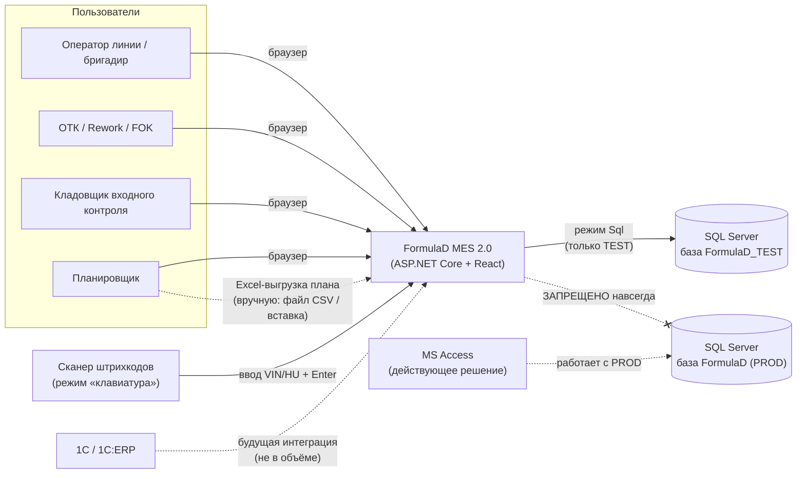
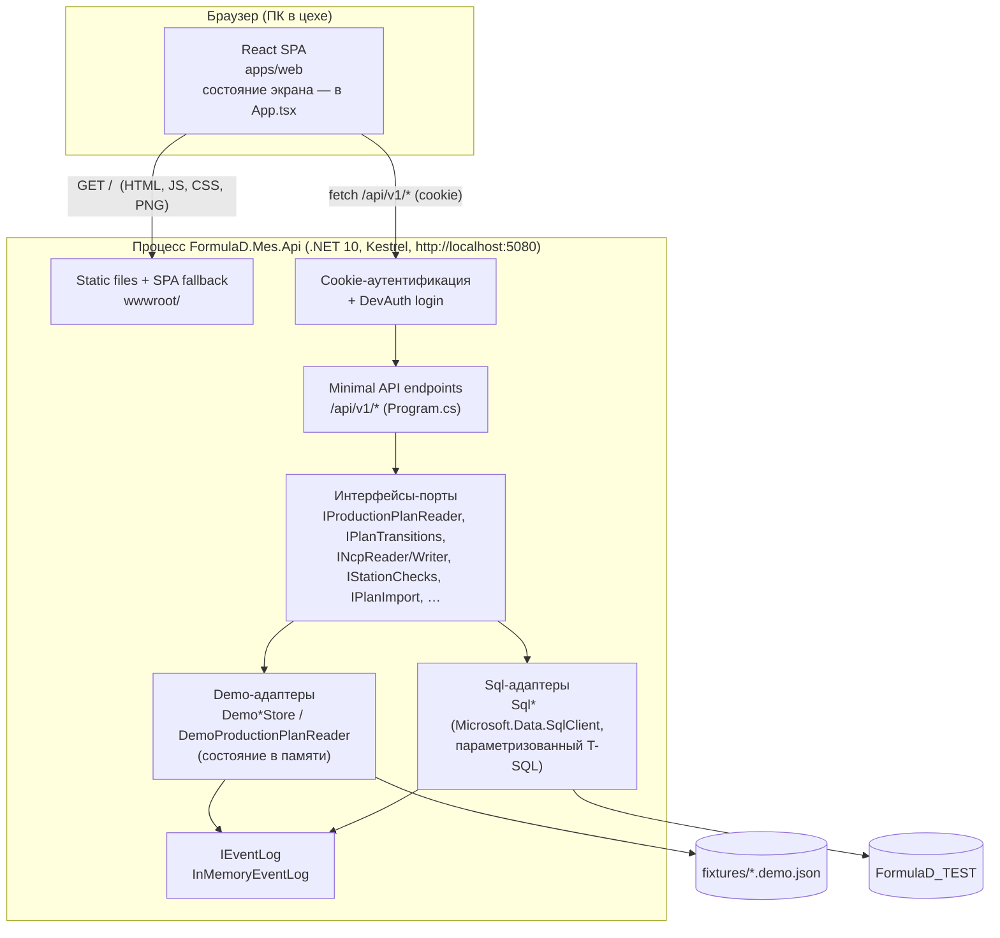
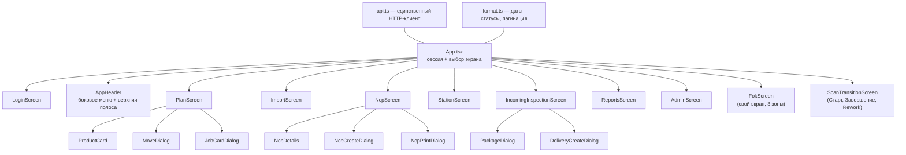
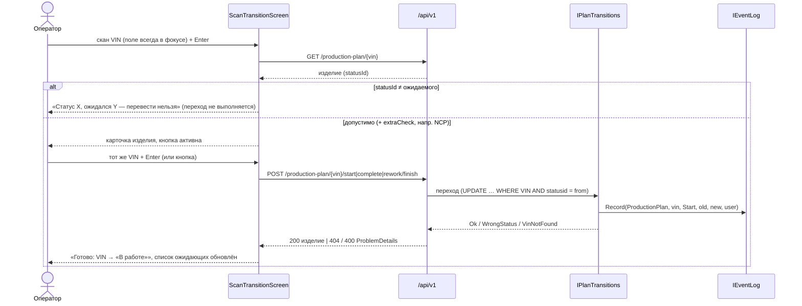
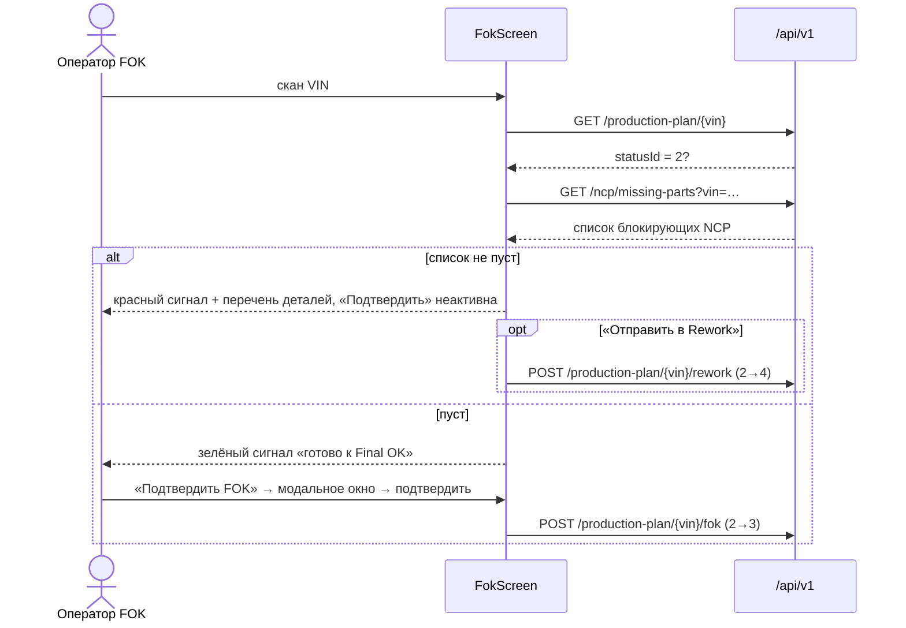
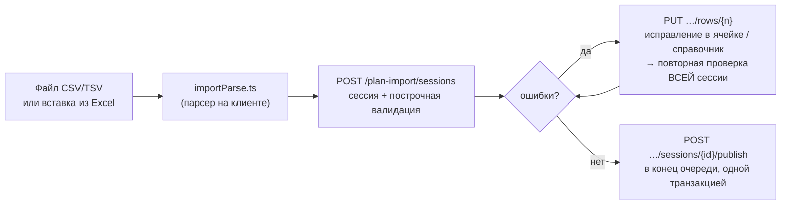

# 02. Архитектура

| | |
|---|---|
| **Назначение** | Как система устроена: компоненты, потоки данных, режимы Demo/Sql, сквозные аспекты и принятые архитектурные решения |
| **Для кого** | Разработчик перед первым изменением кода; ревьюер |
| **Проверено по коммиту** | `fc6f055` |

Детали по слоям: backend — `05-BACKEND-GUIDE`, данные — `06-DATA-AND-SQL`, frontend — `07-FRONTEND-GUIDE`,
контракты — `04-API-REFERENCE`, модель предметной области — `03-DOMAIN-MODEL`.

## Оглавление

1. [Обзор и принципы](#1-обзор-и-принципы)
2. [Контекстная диаграмма](#2-контекстная-диаграмма)
3. [Контейнерная диаграмма](#3-контейнерная-диаграмма)
4. [Компоненты backend](#4-компоненты-backend)
5. [Компоненты frontend](#5-компоненты-frontend)
6. [Режимы Demo и Sql](#6-режимы-demo-и-sql)
7. [Потоки данных](#7-потоки-данных)
8. [Сквозные аспекты](#8-сквозные-аспекты)
9. [Архитектурные решения (ADR)](#9-архитектурные-решения-adr)
10. [Ограничения и компромиссы](#10-ограничения-и-компромиссы)

---

## 1. Обзор и принципы

Система — **модульный монолит**: одно ASP.NET Core приложение, которое отдаёт и REST API (`/api/v1/*`), и собранный React-UI
(статика из `wwwroot/`). Отдельных сервисов, очередей, кэшей, ORM и Docker нет — намеренно (`docs/ARCHITECTURE.md`:
«не создавать отдельные сервисы ради модульности»).

Принципы, на которых всё держится:

1. **Порт и адаптер на каждую возможность.** Каждая «способность» (чтение плана, переходы, NCP, станции, импорт, входной
   контроль, печать) — это интерфейс; у него две реализации: `Demo*` (в памяти, из JSON) и `Sql*` (TEST-база). Экраны и
   эндпоинты про источник ничего не знают.
2. **Fail-closed.** Любая неполная или похожая на PROD конфигурация SQL — исключение при старте, без отката на Demo.
3. **Закрыто по умолчанию.** Без аутентификации — `401`; dev-вход существует физически только в Development.
4. **Сервер — источник правды о бизнес-правилах.** Проверка статусов, блокировка FOK, валидация импорта — на сервере;
   клиент лишь показывает причину.
5. **Неизвестное не ломает UI.** Незнакомый `Status`, `NULL`, пустые даты отображаются как есть.

## 2. Контекстная диаграмма

Пунктир — внешние связи, не являющиеся программным интерфейсом. Связь MES → PROD **запрещена** (см.
[09](09-SECURITY-AND-CONSTRAINTS.md)). Access продолжает работать с PROD независимо от MES.

## 3. Контейнерная диаграмма

В разработке UI запускается отдельно на Vite (`:5173`), а запросы `/api` проксируются на `:5080` (`apps/web/vite.config.ts`).
В «боевой» схеме UI собирается в `src/FormulaD.Mes.Api/wwwroot` (папка в `.gitignore`) и раздаётся самим API.

## 4. Компоненты backend

Один проект `src/FormulaD.Mes.Api` (≈4,7 тыс. строк C#); слои по сборкам не разнесены.

| Файл | Роль |
|---|---|
| `Program.cs` | Конфигурация, выбор источника данных, аутентификация, **все эндпоинты** (Minimal API, группы `/production-plan`, `/ncp`, `/stations`, `/plan-import`, `/incoming-inspection`, `/auth`) |
| `Models.cs` | DTO плана (`ProductionPlanItem`, `Paged<T>`, запросы) |
| `IProductionPlanReader.cs` | Порт чтения плана · `DemoProductionPlanReader.cs` (читает JSON, **один объект реализует сразу несколько портов**), `SqlProductionPlanReader.cs` + `ProductionPlanSql.cs` (тексты запросов) |
| `PlanTransitions.cs` | Порт переходов `0→1→2→3`, `2→4`, `4→2` · `SqlPlanTransitions.cs` |
| `IPlanOrderEditor.cs` | Порт перестановки · `SqlPlanOrderEditor.cs` |
| `JobCardPrinter.cs` | Порт отметки печати · `SqlJobCardPrinter.cs` |
| `PlanImport.cs` | Порты `IPlanPublisher`, `IPlanImport` + демо-реализация (staging, валидация, публикация) · `SqlPlanPublisher.cs`, `SqlPlanImport.cs` |
| `Ncp.cs` | Порты `INcpReader`/`INcpWriter` + `DemoNcpStore` · `SqlNcpStore.cs` |
| `StationChecks.cs` | Порт `IStationChecks` + `DemoStationChecks` · `SqlStationChecks.cs` |
| `IncomingInspection.cs` | Порты `IIncomingInspectionReader/Writer` + `DemoIncomingInspectionStore` (≈670 строк) · `SqlIncomingInspection.cs` (≈810) |
| `VinSearch.cs` | Единое правило поиска VIN для Demo и Sql (по началу / по концу) |
| `SqlOptions.cs` | **Fail-closed валидация** SQL-конфигурации; две строки подключения: чтение (`ApplicationIntent=ReadOnly`) и запись |
| `EventLog.cs` | `IEventLog` / `InMemoryEventLog` |

Соглашения: переходы статусов атомарны (`UPDATE … WHERE VIN=@vin AND statusid=@from`); результат — `TransitionOutcome`
(`Ok`, `VinNotFound`, `WrongStatus`), эндпоинт переводит его в `200` / `404` / `400` (`ProblemDetails` с русским текстом; отдельного `409` в коде нет); пользователь берётся из
`ClaimsPrincipal.Identity.Name`.

## 5. Компоненты frontend

Один SPA (`apps/web/src`, ≈6,8 тыс. строк TS/TSX вместе с тестами). Роутера **нет**: активный экран хранится в
`useState<Screen>` в `App.tsx`, а функция `onNavigate` передаётся всем экранам (следствие: адрес страницы не меняется,
кнопка «Назад» браузера и прямые ссылки на экраны не работают).

- **`api.ts`** — единственное место, где вызывается `fetch`; бросает `ApiError(status, message)`; `credentials: 'same-origin'`.
- **Общий экран перехода.** Старт, Завершение и Rework — тонкие обёртки над `ScanTransitionScreen` (параметры: статус
  «откуда», статус «куда», подпись кнопки, дополнительная проверка, дополнительный блок). FOK имеет **собственный** экран.
- **Стили.** `styles.css` (токены, базовые компоненты, тёмная тема, боковое меню) + `f7-components.css` (компоненты F7:
  экран FOK, общие классы `f7plan*`, анимация кнопок). Состояние темы и меню — атрибуты `data-theme`, `data-sidebar` на `<html>`
  (читаются из `localStorage` до первой отрисовки в `main.tsx`). Подробнее — `08-UI-DESIGN-SYSTEM`.

## 6. Режимы Demo и Sql

Выбор — при старте по `DataSource` (`Demo` по умолчанию, `Sql`; любое другое значение — исключение).

| | **Demo** | **Sql** |
|---|---|---|
| Данные | `fixtures/*.demo.json` → списки в памяти процесса | таблицы `FormulaD_TEST` (`tblProductionPlan`, `tblNCP`, `tblComponent`, …) |
| Запись | в память; **теряется при перезапуске** | реальные `UPDATE/INSERT` в TEST |
| Включается | по умолчанию | `DataSource=Sql` + `Sql:IsTestEnvironment=true` + `Sql:ConnectionString` |
| Проверки старта | — | `SqlOptions.Create`: флаг TEST, база ≠ `FormulaD`, логин ∉ {`sa`,`sa1`}, база указана |
| Подключения | нет | чтение: `ApplicationIntent=ReadOnly`; запись: отдельная строка (та же, без ReadOnly) |
| Журнал событий | `InMemoryEventLog` | **тоже `InMemoryEventLog`** (в БД не пишется) |
| Тесты | основная масса (`ApiFactory`) | только конфигурационные проверки и тексты запросов — **без живого SQL** |

Демо-фикстуры загружаются из папки приложения (`fixtures/` рядом с dll; csproj копирует их из `../../fixtures`). Пути
переопределяются ключами `Demo:*FixturePath`.

> Расхождение с документами: `README.md` и `IMPLEMENTATION_REPORT.md` утверждают, что «в SQL-режиме операций записи нет
> вообще». **Это устарело**: в коде SQL-режима зарегистрированы все пишущие адаптеры (переходы, перестановка, публикация
> плана, NCP, проверки станций, входной контроль). Подробнее — [13](13-ROADMAP-AND-KNOWN-ISSUES.md#3-расхождения-документов-и-кода).

## 7. Потоки данных

### 7.1. Скан → переход статуса (Старт / Завершение / Rework)

Повторный скан **другого** VIN не подтверждает показанное изделие: он запускает новый поиск. Если между поиском и подтверждением
статус изменил другой пользователь, подтверждение вернёт отказ `400` («изделие уже в статусе …»), и UI просит отсканировать VIN заново.

### 7.2. FOK и блокировка по детали

Что именно считается «блокирующей деталью» — в Demo: `NCP.PartInstalled = false`; в Sql: заявки со `Status = 1`
(открытые), т.к. колонки `PartInstalled` в схеме TEST нет (`SqlNcpStore.GetMissingRequiredPartsAsync`). Это **расхождение
семантики** между режимами — [13](13-ROADMAP-AND-KNOWN-ISSUES.md#2-известные-проблемы).

### 7.3. Перестановка порядка

`PlanScreen` в режиме «Изменить порядок» вызывает `POST /production-plan/{vin}/move` с целевой позицией; каждое перемещение
сразу сохраняется (одна транзакция), `reload()` перечитывает страницу, строка подсвечивается на 2,5 с. Выбор «сохранять каждый
шаг» — осознанное решение РП, расходящееся с `SPECIFICATION §7`.

### 7.4. Импорт плана

Основной план не меняется до `publish`; публикация доступна только при нуле ошибок.

### 7.5. Входной контроль

Поставка (`POST /incoming-inspection/deliveries`) → сессия Packing List (`…/packing-list/sessions`, вставка из Excel, проверка,
правки строк, `confirm`) → коробки → открытие по HU (`…/packages/by-hu/{hu}`) → результат по строке
(`…/packages/{id}/rows/{rowId}/result`), при необходимости «увеличить объём» (`…/quota`) → `…/packages/{id}/close`
(и `reopen`); поставка становится «Проверена», когда закрыты все коробки.

## 8. Сквозные аспекты

| Аспект | Реализация |
|---|---|
| **Аутентификация** | Cookie `formulad.mes.session` (`HttpOnly`, `SameSite=Strict`, `Secure` вне Development, 8 ч, скользящая). `POST /dev-auth/login` маппится только при `DevAuth:Enabled` + Development + заданных логине/пароле. API при отсутствии сессии отдаёт `401` (не редирект) — [09](09-SECURITY-AND-CONSTRAINTS.md#3-dev-аутентификация) |
| **Авторизация** | Только «вошёл/не вошёл» (`RequireAuthorization()` на группах). Ролей нет |
| **Журнал событий** | `IEventLog.Record(entityType, entityKey, action, old, new, user)` вызывается из каждой операции записи. Хранилище — **память процесса**; через API не отдаётся. Точка расширения для будущей отправки в 1С |
| **Ошибки** | `ProblemDetails` (`AddProblemDetails`, `UseExceptionHandler`, `UseStatusCodePages`); бизнес-отказы — `400/404` с русским `title`/`detail`; клиент превращает в `ApiError` |
| **Валидация** | На границе API: длина VIN ≤ 50, `page ≥ 1`, `1 ≤ pageSize ≤ 100`; бизнес-проверки — в портах |
| **Время** | Серверное `DateTime.Now` без зоны; клиент показывает как есть |
| **Локализация** | Только русский; строки в коде; без i18n-библиотеки |
| **Конфигурация** | `appsettings.json` + переменные окружения (`Section__Key`) + user-secrets (`UserSecretsId=formulad-mes2-api`) |
| **Логирование** | Стандартное; источник данных пишется без хоста/базы/учётки; секреты не логируются |
| **Состояние UI** | Локально в компонентах; `localStorage` — тема, свёрнутость меню, раскладка колонок; общего стора нет |
| **Печать** | Браузерная (`window.print`) с отдельными печатными компонентами (`JobCard`, `NcpSheet`, `NcpSummarySheet`); QR — библиотека `qrcode` в браузере |

## 9. Архитектурные решения (ADR)

| № | Контекст | Решение | Последствия |
|---|---|---|---|
| ADR-01 | Нужна простая, быстро поставляемая система под одного заказчика | Модульный монолит: один проект API, слои не вынесены в сборки | Меньше файлов; границы поддерживаются дисциплиной (интерфейсы), а не компилятором; `Program.cs` разросся до ~780 строк |
| ADR-02 | Нужно показывать UI до готовности SQL и не трогать PROD | Порт/адаптер на каждую возможность; `Demo*` и `Sql*` выбираются при старте | Экраны не знают об источнике; но **два набора реализаций надо синхронизировать** (уже есть расхождение по FOK) |
| ADR-03 | Риск случайно подключиться к PROD | Fail-closed `SqlOptions`: флаг TEST + запрет базы `FormulaD` + запрет `sa`/`sa1`; нет отката на Demo | Ошибка конфигурации = отказ старта. **Проверка хоста сознательно убрана** (TEST живёт на том же экземпляре, что и PROD) — защита держится на имени базы, логине и правах логина |
| ADR-04 | Нужна аутентификация, но корпоративный IdP не выбран (В-04) | Временный DevAuth: cookie, логин/пароль из окружения, loopback, маршрут не существует вне Development | Вход возможен только локально; **для сетевого развёртывания нужен реальный IdP** |
| ADR-05 | Нужно развернуть как одну единицу на Windows-сервере | API отдаёт статику UI (`UseDefaultFiles`+`UseStaticFiles`+SPA fallback); `UseWindowsService` | Нет отдельного веб-сервера; `wwwroot` не в git — UI надо собрать перед публикацией |
| ADR-06 | Нужна безопасность запросов и контроль планов выполнения | «Голый» ADO.NET (`Microsoft.Data.SqlClient`) с параметрами и белым списком колонок; EF не используется | Нет миграций/ORM; SQL лежит в коде; запросы легко ревьюить; схема таблиц, которых нет в TEST, создаётся приложением (`EnsureTables`) |
| ADR-07 | Нужен журнал событий для всех операций записи | `IEventLog` заводится один раз до остальных операций; реализация в памяти | Журнал уже вызывается везде, но **не хранится** и не виден пользователю (долг) |
| ADR-08 | В спецификации перестановка — «черновик + Сохранить/Отменить» | Сохранять каждый шаг сразу (решение РП 27.10.2026) | Проще и без блокировок; нет отката серии; конфликты двух диспетчеров не контролируются |
| ADR-09 | Excel-файл `.xlsx` требует парсера | Свой парсер CSV/TSV + вставка диапазона; пакет `xlsx` отклонён (незакрытые уязвимости) | Нет зависимостей; бинарный `.xlsx` напрямую не поддерживается |
| ADR-10 | Старт/Завершение/Rework одинаковы по механике | Один общий `ScanTransitionScreen`, параметризуемый | Единый UX и тесты; FOK вынесен в отдельный экран из-за особого макета |
| ADR-11 | Маленькое приложение, мало экранов | Без роутера: `useState<Screen>` | Просто; нет deep-links и истории браузера |
| ADR-12 | Два уровня доверия к строкам | Клиентский `api.ts` как единственный HTTP-слой; сервер — источник бизнес-правил | Клиент не дублирует правила, только отображает причину |
| ADR-13 | Поиск VIN должен быть быстрым на пути сканера | Два режима (`VinSearch`): по началу — по индексу PK; только цифры — по концу | Быстрый путь сканера; ручной поиск «последних цифр» — скан таблицы; опирается на допущение «VIN всегда с буквами» |

## 10. Ограничения и компромиссы

- **SQL-режим не проверялся на живой TEST-базе в этой среде** (SQL Server недоступен): проверены конфигурация, тексты запросов и
  маршруты, но не сами запросы. Первое реальное подключение — риск.
- **Состояние Demo в памяти**: несколько экземпляров процесса не синхронизируются; перезапуск сбрасывает всё.
- **Нет оптимистической блокировки** (`rowversion`) при перестановке и правках NCP: два пользователя перезапишут друг друга
  последним записавшим (`SPECIFICATION AT-30` не покрыт).
- **Нет идемпотентности** повторных нажатий (`AT-29`); частично смягчено условием `WHERE statusid = from` в переходах.
- **Одна учётная запись SQL** на чтение и запись (две строки подключения различаются только `ApplicationIntent`).
- **Тихие точки роста**: `Program.cs` (все эндпоинты в одном файле), крупные файлы `IncomingInspection.cs` / `SqlIncomingInspection.cs`,
  отсутствие общего стора на фронте.
- **Печать — браузерная**: макеты JobCard/NCP не согласованы с цехом (В-12, В-21).
