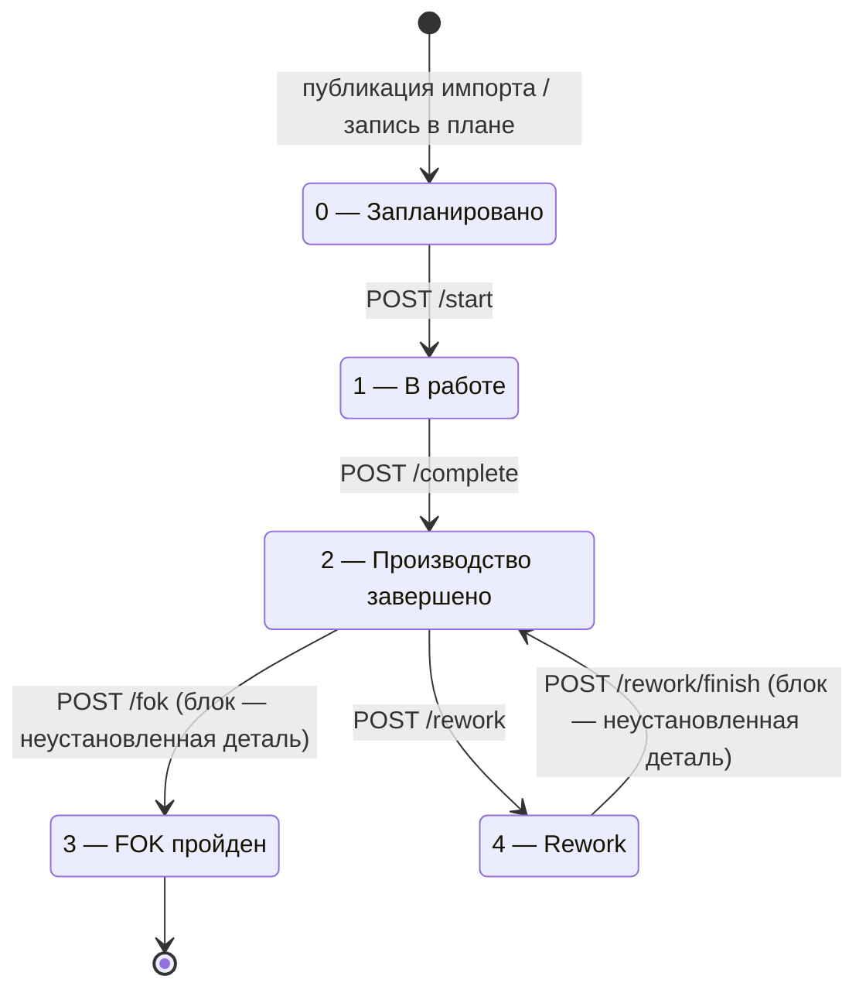
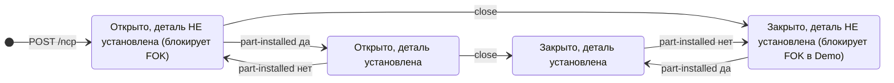
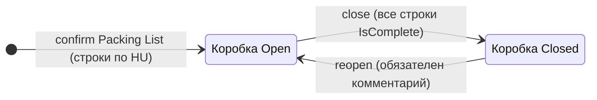

# 03. Доменная модель и бизнес-правила

| | |
|---|---|
| **Назначение** | Описать сущности, статусы, переходы и бизнес-правила бэкенда FormulaD MES 2.0 ровно так, как они реализованы в коде. |
| **Для кого** | Разработчик, которому нужно изменить правило, добавить поле или понять, почему API ответил отказом. |
| **Проверено по коммиту** | `fc6f055` (ветка `claude/new-session-bizv59`) |
| **Источник правды** | Код в [`src/FormulaD.Mes.Api`](../../src/FormulaD.Mes.Api/) и тесты в [`tests/FormulaD.Mes.Api.Tests`](../../tests/FormulaD.Mes.Api.Tests/). Требования — [`../SPECIFICATION.md`](../SPECIFICATION.md). При расхождении верьте коду; расхождения помечены блоками «Расхождение». |

## Оглавление

1. [Общие соглашения](#1-общие-соглашения)
2. [Сущности](#2-сущности)
3. [Статусы изделия и переходы](#3-статусы-изделия-и-переходы)
4. [Бизнес-правила](#4-бизнес-правила)
5. [Журнал событий](#5-журнал-событий)
6. [Расхождения SQL и test doubles](#6-расхождения-sql-и-test-doubles)
7. [Что не подтверждено кодом](#7-что-не-подтверждено-кодом)

---

## 1. Общие соглашения

- **Ключ изделия — `VIN`** (строка 1..50 символов). Сравнение VIN в Demo нечувствительно к регистру (`StringComparison.OrdinalIgnoreCase`), в SQL зависит от collation базы (не подтверждено кодом).
- **JSON на проводе** — camelCase (настройки ASP.NET Core по умолчанию). Свойства записей C# `Vin`, `StatusId` становятся `vin`, `statusId`. Вычисляемые свойства (`Delivery.Status`, `Package.IsComplete` и т. п.) тоже сериализуются.
- **Даты** — `DateTime` без часового пояса. В Demo это `DateTime.Now` сервера, в SQL — значение `datetime` как есть. Конвертации в UTC нет намеренно (комментарий в `Models.cs`: политика зон не согласована).
- **Пользователь операции** — `user.Identity?.Name`, при его отсутствии строка `"неизвестно"`. Ролей нет: любой вошедший пользователь может выполнять любую операцию.
- **Исходы операций** — доменные методы возвращают enum-исход (`TransitionOutcome`, `MoveOutcome`, `CreateNcpOutcome` и др.), а `Program.cs` переводит его в HTTP-ответ (см. [04-API-REFERENCE.md](04-API-REFERENCE.md)).
- **Статусы-строки на проводе** — `NcpItem.Status`, `Package.Status`, `Delivery.Status` — обычные строки, не enum (сознательное решение, см. комментарий к `PackageStatuses` в `IncomingInspection.cs`).

## 2. Сущности

### 2.1. Изделие плана — `ProductionPlanItem`

Определено в [`Models.cs`](../../src/FormulaD.Mes.Api/Models.cs). В SQL — проекция `dbo.tblProductionPlan`.

| Поле | Тип | Смысл | Колонка SQL |
|---|---|---|---|
| `Vin` | `string` | Ключ изделия | `VIN` |
| `Id` | `int` | Справочный числовой ID, **не ключ** | `ID` |
| `Seqn` | `int?` | Порядок в плане сборки; `null` — изделие вне очереди | `SEQN` |
| `ModelArticle` / `ModelName` | `string?` | Артикул и название модели | `ModelArticle` / `ModelName` |
| `EngineNumber` | `string?` | Номер двигателя | `EngineNumber` |
| `Color` | `string?` | Цвет | `Color` |
| `SpecificationName` | `string?` | Комплектация | `SpecificationName` |
| `Status` | `string?` | Строковый статус «как в базе» | `Status` |
| `StatusId` | `int?` | Числовой статус 0..4 (раздел 5 спецификации) | `statusid` |
| `PrintDate` | `DateTime?` | Дата печати JobCard | `PrintDate` |
| `PlannedStartDate` | `DateTime?` | План старта | `plannedstartdate` |
| `PlannedCompleteDate` | `DateTime?` | План завершения | **нет отдельной колонки** — в SQL заполняется из `PlannedShipmentDate`, см. [расхождение 6.4](#64-дата-план-завершения) |
| `PlannedShipmentDate` | `DateTime?` | План отгрузки | `PlannedShipmentDate` |
| `StartDate` | `DateTime?` | Факт запуска | `StartDate` |
| `CompleteDate` | `DateTime?` | Факт завершения сборки | `CompleteDate` |
| `FokDate` | `DateTime?` | Факт Final OK | `FOK_date` |

Связанные типы:

- `PagedResult<T>(Items, Page, PageSize, Total)` — универсальная страница.
- `ProductionPlanQuery(Vin, Status, StatusId, Page, PageSize)` — параметры списка. **`Status` (строка) и `StatusId` (число) фильтруют разные колонки** (`Status` и `statusid`), не путать. `Status = ""` означает «записи без статуса» (`Status IS NULL`).

В SQL-записях бывают значения вне 0..4 и `NULL`: фикстура намеренно содержит изделие `DEMO-VIN-00005` без статуса и `DEMO-VIN-00006` со статусом `88` / `custom_unknown`. Бэкенд такие значения не прячет и не нормализует; сообщения об ошибках для неизвестного кода выводят `код N` (функция `StatusLabel` в `Program.cs`).

### 2.2. Несоответствие — `NcpItem`

Определено в [`Ncp.cs`](../../src/FormulaD.Mes.Api/Ncp.cs).

| Поле | Тип | Смысл |
|---|---|---|
| `Id` | `int` | Идентификатор заявки |
| `Number` | `string` | Человекочитаемый номер. Demo: `NC-{год}-{id:D4}` (например `NC-2026-0001`); SQL: `NC-{id}` |
| `Vin` | `string` | Изделие (в базе — FK на `tblProductionPlan.VIN`) |
| `Station` | `string` | Номер станции (строка) |
| `ComponentCode` / `ComponentName` | `string` | Компонент из справочника |
| `Quantity` | `int` | 1..9999 |
| `Type` | `string` | `Брак`, `Пересорт`, `Недостача`, `Прочее` (Demo, `DemoNcpStore.Types`); в SQL — значения `tblDiscrepancyList.discrepancy` |
| `OperatorComment` / `EngineerComment` | `string?` | Комментарии оператора и инженера. В SQL `EngineerComment` всегда `null` (одна колонка `Comment`) |
| `Status` | `string` | `Открыто` или `Закрыто` |
| `PartInstalled` | `bool` | Установлена ли корректная деталь. **Отдельно от `Status`** (в Demo) |
| `CreatedAt` / `CreatedBy` | `DateTime` / `string` | Кто и когда зарегистрировал |
| `ClosedAt` / `ClosedBy` | `DateTime?` / `string?` | Кто и когда закрыл |

Справочные типы: `ComponentItem(Code, Name, Station?)`, `NcpQuery(Vin, Status, Page, PageSize)`. Запросы: `CreateNcpRequest(Vin, Station, ComponentCode, Quantity, Type, OperatorComment?)`, `SetPartInstalledRequest(Installed)`, `CloseNcpRequest(EngineerComment?)`.

### 2.3. Отметка проверки компонента — `ComponentCheck`

Определено в [`StationChecks.cs`](../../src/FormulaD.Mes.Api/StationChecks.cs): `ComponentCheck(ComponentCode, Checked, CheckedBy?, CheckedAt?)`. Станция отдельно не хранится: она берётся из компонента (`ComponentItem.Station`). Ответ `GET /stations/{vin}/checks` — словарь «код компонента → отметка»; отсутствие ключа означает «ещё не проверялся». Цвет станции (серый, синий, зелёный, жёлтый, красный) **вычисляет фронтенд**, бэкенд такого поля не отдаёт (см. `StationScreen.tsx`, функция `stationState`).

### 2.4. Импорт плана

Определено в [`PlanImport.cs`](../../src/FormulaD.Mes.Api/PlanImport.cs).

| Тип | Поля | Заметка |
|---|---|---|
| `ImportRawRow` | `Vin, ModelArticle, EngineNumber, Color, SpecificationName, PlannedStartDate, PlannedCompleteDate, PlannedShipmentDate` — все `string?` | Сырая строка «как пришла»; разбор дат происходит при проверке |
| `ImportRowResult` | `RowNumber`, `Row`, `Errors[]`, вычисляемое `IsValid` | `RowNumber` — с 1 |
| `ImportSession` | `Id, CreatedAt, CreatedBy, Source, Rows[]`, вычисляемые `TotalCount`, `ErrorCount` | Хранится **в памяти процесса**, после перезапуска исчезает |
| `PlanReference` | `Models[ModelRef(Article, Name)], Colors[], Specifications[]` | Справочники для проверки |
| `NewPlanRow` | VIN, модель, двигатель, цвет, комплектация, три плановые даты | Внутренний тип: строка после успешной проверки, передаётся в `IPlanPublisher` |
| `StageImportRequest` | `Rows[], Source` | Тело `POST /plan-import/sessions` |

### 2.5. Входной контроль

Определено в [`IncomingInspection.cs`](../../src/FormulaD.Mes.Api/IncomingInspection.cs). Иерархия (раздел 19 спецификации): **Поставка → Упаковка (коробка, HU) → Строка комплектующих**.

| Тип | Поля | Заметка |
|---|---|---|
| `SupplierRef` | `Code, Name, IsParentPlant` | Справочник поставщиков |
| `InspectionQuotaRef` | `ComponentCode, Percent?, FixedCount?` | Норматив контроля артикула; задан максимум один из двух |
| `PackingListRawRow` | `PackageNumber, Article, ComponentName, Quantity, NetWeight, GrossWeight, Batch` — все `string?` | Сырая строка Packing List; первая колонка — номер упаковки (HU) |
| `PackingListRowResult` | `RowNumber, Row, Errors[], PreviewRequiredQuantity?`, `IsValid` | `PreviewRequiredQuantity` — предпросмотр объёма контроля |
| `PackingListSession` | `Id, DeliveryId, CreatedAt, CreatedBy, Rows[]`, `TotalCount`, `ErrorCount` | В памяти процесса |
| `PackingListRow` | `Id, ComponentCode, ComponentName, PlannedQuantity, NetWeight?, GrossWeight?, Batch?, RequiredQuantity, OkQuantity, DefectQuantity, MismatchQuantity, ShortageQuantity, DiscrepancyReason?`; вычисляемые `CheckedQuantity, IsComplete, HasIssues` | Учёт агрегированный по строке, счётчики независимы |
| `Package` | `Id, DeliveryId, HuNumber, Status, ClosedAt?, ClosedBy?, Rows[]`; вычисляемые `IsComplete, HasIssues` | `Status`: `Open` / `Closed` |
| `Delivery` | `Id, SupplierCode, SupplierName, InvoiceNumber, InvoiceDate, AccompanyingDocument?, CreatedAt, CreatedBy, Packages[]`; вычисляемое `Status` | `Id` — Guid в формате `N` (Demo); `Status`: `Open` / `Verified` / `VerifiedWithIssues` |

Формулы вычисляемых полей (код, не комментарии):

- `PackingListRow.CheckedQuantity = Ok + Defect + Mismatch + Shortage`
- `PackingListRow.IsComplete = CheckedQuantity >= RequiredQuantity`
- `PackingListRow.HasIssues = Defect > 0 || Mismatch > 0 || Shortage > 0`
- `Package.IsComplete = Rows.Count > 0 && все строки IsComplete`
- `Package.HasIssues = любая строка HasIssues`
- `Delivery.Status`: `Open`, если нет упаковок или не все `Closed`; иначе `VerifiedWithIssues`, если у какой-то упаковки `HasIssues`; иначе `Verified`.

### 2.6. Служебные типы

- `EventLogEntry(Id, EntityType, EntityKey, Action, OldValue?, NewValue?, UserName, OccurredAt)` — запись журнала, см. [раздел 5](#5-журнал-событий).
- `DevAuthOptions(Enabled, Username?, Password?)` с `CanLogIn = Enabled && есть логин и пароль`; сравнение пароля — `CryptographicOperations.FixedTimeEquals`. `DevAuthLoginRequest(Username, Password)`.
- `MoveRequest(ToPosition)`, `SetCheckRequest(Checked)`.

## 3. Статусы изделия и переходы

### 3.1. Коды статуса

Источник: `StatusLabel` в `Program.cs` и раздел 5 спецификации.

| `statusId` | Название в UI/ошибках | Литерал `Status`, который пишет код |
|---|---|---|
| `0` | Запланировано | `planned` (при публикации импорта) |
| `1` | В работе | `in progress` |
| `2` | Производство завершено | `complete` |
| `3` | FOK пройден | `FOK` |
| `4` | Rework | `rework` |
| `null` | без статуса | — |
| прочее | `код N` | — |

> Литералы `in progress`, `complete`, `FOK` подтверждены аудитом Access (комментарий в `DemoProductionPlanReader`). Литерал `rework` аудитом **не подтверждён** (там же); сверить на TEST-базе.

### 3.2. Диаграмма

Прямого перехода `1 → 4` нет (комментарий в `PlanTransitions.cs`: не согласован, вопрос В-07). Перехода из `3` нет вообще.

### 3.3. Таблица переходов

Все переходы идут через `IPlanTransitions` ([`PlanTransitions.cs`](../../src/FormulaD.Mes.Api/PlanTransitions.cs)). Атомарность: в Demo — под общей блокировкой `_gate`; в SQL — один `UPDATE ... WHERE [VIN]=@vin AND [statusid]=@from` (0 затронутых строк → исход `VinNotFound` или `WrongStatus`).

| Переход | Эндпоинт | Метод | Допустим из | Что меняется (Demo) | Что пишет SQL (`SqlPlanTransitions`) | Доп. проверка на уровне эндпоинта | Действие в журнале |
|---|---|---|---|---|---|---|---|
| Запуск | `POST /api/v1/production-plan/{vin}/start` | `StartAsync` | `0` | `StatusId=1`, `Status="in progress"`, `StartDate=Now` | `statusid=1`, `Status='in progress'`, `StartDate=@now` | нет | `Start` |
| Завершение сборки | `…/{vin}/complete` | `CompleteAsync` | `1` | `StatusId=2`, `Status="complete"`, `CompleteDate=Now` | `statusid=2`, `Status='complete'`, `CompleteDate` | **нет**: открытые NCP завершение не блокируют (намеренно, раздел 13 спецификации) | `Complete` |
| Final OK | `…/{vin}/fok` | `FokAsync` | `2` | `StatusId=3`, `Status="FOK"`, `FokDate=Now` | `statusid=3`, `Status='FOK'`, `FOK_date` | **да**: `INcpReader.GetMissingRequiredPartsAsync(vin)` должен вернуть пусто, иначе 400 «FOK недоступен» | `FOK` |
| В Rework | `…/{vin}/rework` | `SendToReworkAsync` | `2` | `StatusId=4`, `Status="rework"` (`CompleteDate` не трогается) | `statusid=4`, `Status='rework'`, `reworkdate` | нет | `SendToRework` |
| Конец Rework | `…/{vin}/rework/finish` | `FinishReworkAsync` | `4` | `StatusId=2`, `Status="complete"` | `statusid=2`, `Status='complete'`, `reworkcompletedate` | **да**: та же проверка неустановленной детали, 400 «Rework не завершён» | `FinishRework` |

Исходы: `Ok` → 200 с обновлённым изделием; `VinNotFound` → 404; `WrongStatus` → 400 «Нельзя …» с текстом «Изделие уже в статусе «X», ожидался «Y»». Повторный вызов того же перехода всегда даёт `WrongStatus` и ничего не перезаписывает (раздел 10 спецификации: повторный запуск не сбрасывает прежние события).

Порядок в обработчике `fok` и `rework/finish`: сначала валидация длины VIN, **затем** проверка NCP, **затем** переход. Следствие: для изделия не в нужном статусе, но с неустановленной деталью, ответом будет «FOK недоступен» (причина NCP), а не «неверный статус».

## 4. Бизнес-правила

### 4.1. Блокировка FOK незакрытой деталью

Правило (раздел 16 спецификации): допуск к FOK определяется **фактом установки детали, а не наличием записей NCP**.

Реализация — метод `INcpReader.GetMissingRequiredPartsAsync(vin)`:

| Режим | Что считается блокирующим |
|---|---|
| **Demo** (`DemoNcpStore`) | Любая NCP этого VIN с `PartInstalled == false`, **независимо от `Status` и `Type`**. Закрытая без установки заявка тоже блокирует |
| **SQL** (`SqlNcpStore`) | Любая NCP этого VIN со `Status = 1` (открыта) |

> **Расхождение с docs/SPECIFICATION.md (раздел 16) и комментарием в `Ncp.cs`.** Спецификация и XML-комментарии говорят про «обязательную деталь» и отдельный признак установки. В коде нет понятия «обязательная»: блокирует любая NCP. В SQL-режиме признака установки нет вообще — он приравнен к закрытию заявки (см. [6.1](#61-ncp-признак-установки-детали)).

Проверка выполняется в обработчиках эндпоинтов (`httpCtx.RequestServices.GetService<INcpReader>()`), а не в `IPlanTransitions`: сам переход «ничего не знает про NCP», чтобы не связывать план и модуль несоответствий (комментарий в `PlanTransitions.cs`). Если `INcpReader` не зарегистрирован, проверка молча пропускается; в обоих режимах он зарегистрирован.

Тесты: [`FokTests.cs`](../../tests/FormulaD.Mes.Api.Tests/FokTests.cs) (блокировка, разблокировка после «деталь установлена»), [`CompleteTests.cs`](../../tests/FormulaD.Mes.Api.Tests/CompleteTests.cs) (завершение не блокируется).

### 4.2. Rework

- Вход: `2 → 4` кнопкой «Отправить в Rework» (в UI — на экране FOK, когда изделие заблокировано; вопрос В-19 «какое действие запускает» не согласован).
- Выход: `4 → 2` с повторной проверкой неустановленной детали (раздел 17 спецификации).
- Открытые NCP изделия видны и управляются из экрана Rework через `GET /ncp?vin=`, `POST /ncp/{id}/part-installed`, `POST /ncp/{id}/close`.
- Тесты: [`ReworkTests.cs`](../../tests/FormulaD.Mes.Api.Tests/ReworkTests.cs).

### 4.3. Перестановка очереди

Реализация: `IPlanOrderEditor.MoveAsync(vin, toPosition, userName)`, Demo — `DemoProductionPlanReader.MoveAsync`, SQL — `SqlPlanOrderEditor.MoveAsync` (одна транзакция).

Алгоритм (одинаков в обоих режимах):

1. Берутся все изделия с `SEQN IS NOT NULL`, упорядоченные по `SEQN`. Набор номеров позиций фиксируется.
2. Изделие вынимается из списка и вставляется на индекс, где сейчас стоит номер `toPosition`.
3. Прежние номера позиций раздаются заново **по новому порядку**. Набор номеров не меняется: сплошная нумерация остаётся сплошной, «дырявая» — такой же дырявой.
4. В SQL обновляются только строки, у которых `SEQN` действительно сменился.

Исходы (`MoveOutcome`): `Ok` → 200 + обновлённое изделие; `VinNotFound` → 404; `NoPosition` (у изделия `SEQN IS NULL`) → 400 «Нет позиции в плане»; `PositionNotFound` (такого номера в плане нет) → 400 «Позиция не найдена». `toPosition < 1` отклоняется в обработчике (400).

Ограничений по статусу изделия код не накладывает: двигать можно изделие в любом статусе (не подтверждено спецификацией, подтверждено отсутствием проверки в коде). Журнал: сущность `ProductionPlan`, действие `Move`, старое и новое значение — номера позиций.

Проект операции — [`../REORDER_DESIGN.md`](../REORDER_DESIGN.md).

### 4.4. Поиск по VIN

Единое правило `VinSearch.IsSuffixSearch` ([`VinSearch.cs`](../../src/FormulaD.Mes.Api/VinSearch.cs)): строка из **одних цифр** — поиск по **концу** VIN; любая другая — поиск по **началу**. Причина: сканер отдаёт VIN целиком (с буквами), человек вручную набирает последние цифры; единое условие «начало ИЛИ конец» заставило бы SQL Server сканировать таблицу и на быстром пути сканера. Допущение: VIN всегда содержит буквы; появятся полностью цифровые VIN — правило пересмотреть. Правило применяется и к плану, и к списку NCP, в Demo и в SQL. Поиск по середине VIN не поддерживается.

### 4.5. NCP: «деталь установлена» и «закрыть» — разные состояния

Требование (раздел 16): «заявка закрыта» не значит «деталь физически стоит». Два независимых признака.

На диаграмме подписи «да/нет» — значение `installed` в запросе `POST /ncp/{id}/part-installed`. Диаграмма описывает **Demo**. Правила Demo-реализации (`DemoNcpStore`):

- Создание: только на существующий VIN; станция из списка `1..11`; компонент из справочника; `Quantity` 1..9999; `Type` из `Брак/Пересорт/Недостача/Прочее`. Порядок проверок и исход: `VinNotFound`, `InvalidStation`, `ComponentNotFound`, `InvalidQuantity`, `InvalidType`. Новая заявка: `Status="Открыто"`, `PartInstalled=false`.
- `SetPartInstalledAsync`: идемпотентно (то же значение → 200 без записи в журнал). **Статус заявки не проверяется**: признак можно менять и у закрытой заявки.
- `CloseAsync`: закрывает независимо от `PartInstalled`; повторное закрытие → `AlreadyClosed` (400 «Уже закрыто»). `EngineerComment` перезаписывается, только если передан непустой (пустая строка обрезается до `null` и старый комментарий сохраняется).
- Списки: новые сверху (`CreatedAt DESC, Id DESC`); фильтр `status` — точное совпадение строки.

В **SQL** разделения нет, см. [6.1](#61-ncp-признак-установки-детали).

### 4.6. Отметки станций

`IStationChecks` ([`StationChecks.cs`](../../src/FormulaD.Mes.Api/StationChecks.cs)). `SetCheckedAsync(vin, componentCode, checked, author)`: VIN должен существовать, компонент — быть в справочнике (`ComponentNotFound`). Снятие отметки обнуляет `CheckedBy`/`CheckedAt`. В журнал пишется только реальная смена состояния (Demo), в SQL — каждое обращение. Тесты: [`StationChecksTests.cs`](../../tests/FormulaD.Mes.Api.Tests/StationChecksTests.cs).

### 4.7. Импорт плана

Конвейер (раздел 6 спецификации): **вставка → проверка → исправление → публикация**, `IPlanImport` + `IPlanPublisher`.

1. `POST /plan-import/sessions` — приём 1..500 строк, проверка **всех** строк, создание сессии (даже с ошибками).
2. `PUT /plan-import/sessions/{id}/rows/{n}` — замена одной сырой строки и **повторная проверка всей сессии** (так ловятся дубли между строками).
3. `POST /plan-import/sessions/{id}/publish` — только при `ErrorCount == 0`; иначе 400 «Нельзя опубликовать».

Правила проверки строки (`ValidateRowAsync`, одинаковы в SQL и test doubles):

| Поле | Ошибка |
|---|---|
| VIN | не указан; длиннее 50; повторяется в этой загрузке; **уже есть в плане** (всегда ошибка, вопрос В-09) |
| Номер двигателя | не указан; длиннее 50; повторяется в этой загрузке |
| Модель | не указана; артикул не из справочника моделей |
| Цвет | не указан; нет в справочнике цветов (без учёта регистра) |
| Комплектация | не указана; нет в справочнике комплектаций |
| Три плановые даты | необязательны; если указаны — формат `yyyy-MM-dd`, `dd.MM.yyyy` или `yyyy-MM-ddTHH:mm:ss` |

Публикация: все строки одной операцией (Demo — под общей блокировкой, SQL — одна транзакция) **в конец очереди**: `SEQN = max(SEQN)+1`, далее по порядку; `Status="planned"`, `StatusId=0`; название модели берётся из справочника по артикулу. После успеха сессия удаляется, повторная публикация того же `id` даёт 404 (защита от двойного нажатия). Справочники: Demo — фикстуры `models/colors/specifications`; SQL — `SELECT DISTINCT` из `tblProductionPlan` (см. [06](06-DATA-AND-SQL.md)).

> **Особенность SQL-публикации.** `SqlPlanPublisher` не вставляет `PlannedCompleteDate` (нет такой колонки в `INSERT`). Дата «завершение (план)» из импорта в SQL-режиме теряется. В Demo она сохраняется.

Тесты: [`PlanImportTests.cs`](../../tests/FormulaD.Mes.Api.Tests/PlanImportTests.cs).

### 4.8. Входной контроль

Иерархия и статусы — [раздел 2.5](#25-входной-контроль).

Статус поставки не хранится, а вычисляется (`Delivery.Status`): «проверена» ровно тогда, когда закрыты все коробки. Переоткрытие коробки автоматически возвращает поставку в `Open`.

**Загрузка Packing List** (`StagePackingListAsync` → `ReplaceRowAsync` → `ConfirmSessionAsync`) — тот же паттерн «временная область», что у импорта плана. Проверка строки: HU не пуст; артикул указан и есть в справочнике (иначе «добавьте его в справочник» — `POST /incoming-inspection/components`); количество — положительное целое; вес нетто/брутто — число, если указан. Подтверждение возможно только при нуле ошибок; строки группируются по номеру HU (без учёта регистра). Если коробка с таким HU уже есть, строки **добавляются к ней** (статус существующей коробки не проверяется).

**Норматив контроля** (`ComputeRequiredQuantity`), считается один раз при подтверждении строки и дальше не пересчитывается:

- есть `FixedCount` → `clamp(FixedCount, 0, PlannedQuantity)`;
- иначе процент (`Percent`, по умолчанию **100**) → `ceil(PlannedQuantity × Percent / 100)`, ограничен `PlannedQuantity`.

**Запись результата** `POST /packages/{id}/rows/{rowId}/result` (`RecordRowResultAsync`):

| Условие | Исход | HTTP |
|---|---|---|
| `Outcome` не из `OK / Брак / Пересорт / Недостача` | `InvalidOutcome` | 400 |
| `Quantity < 1` | `InvalidQuantity` | 400 |
| коробка/строка не найдена | `NotFound` | 404 |
| коробка `Closed` | `PackageClosed` | 400 |
| `CheckedQuantity + Quantity > RequiredQuantity` | `ExceedsRequired` | 400 |

Счётчики независимы и накапливаются: найденный дефект не переносится автоматически на непроверенные штуки (раздел 21). Недостача входит в `CheckedQuantity`, потому что физически не поступившее проверить нельзя (рабочая рекомендация В-31). Причина (`Reason`) перезаписывает `DiscrepancyReason` для Брак/Пересорт/Недостача, если непустая.

**Увеличение норматива** `POST …/quota` (`IncreaseQuotaAsync`): комментарий обязателен (проверка в обработчике, 400 «Нужен комментарий»); новый объём должен быть **строго больше** текущего и **не больше `PlannedQuantity`**; в закрытой коробке нельзя.

**Закрытие** `POST …/close`: коробка должна быть `IsComplete` (иначе `NotComplete`, наружу как 400 «Нельзя закрыть»); закрытие — отдельное явное действие, а не следствие последнего скана (раздел 23). **Переоткрытие** `POST …/reopen`: комментарий обязателен; уже открытую переоткрыть нельзя (400 «Нельзя переоткрыть»).

Тесты: [`IncomingInspectionTests.cs`](../../tests/FormulaD.Mes.Api.Tests/IncomingInspectionTests.cs).

### 4.9. Печать JobCard

`IJobCardPrinter.MarkPrintedAsync(vin, userName)` ([`JobCardPrinter.cs`](../../src/FormulaD.Mes.Api/JobCardPrinter.cs)): записывает `PrintDate = Now`, возвращает изделие, **статус не меняет** и новое изделие не создаёт (раздел 8: повторная печать не порождает новый VIN). Разрешена в любом статусе. Сама печатная форма и QR-код формируются во фронтенде; в бэкенде нет генерации QR (подробнее — [`../PRINTED_CARDS.md`](../PRINTED_CARDS.md)). Тесты: [`JobCardPrintTests.cs`](../../tests/FormulaD.Mes.Api.Tests/JobCardPrintTests.cs).

## 5. Журнал событий

Интерфейс `IEventLog` ([`EventLog.cs`](../../src/FormulaD.Mes.Api/EventLog.cs)): `Record(entityType, entityKey, action, oldValue, newValue, userName)` и `Query(entityType, entityKey, limit)`. Реализация одна — `InMemoryEventLog`: список в памяти процесса, **не переживает перезапуск**, и в Demo, и в SQL.

> **Журнал не доступен через API.** В `Program.cs` нет маршрута, который вызывает `IEventLog.Query`; чтение журнала покрыто только юнит-тестами [`EventLogTests.cs`](../../tests/FormulaD.Mes.Api.Tests/EventLogTests.cs). Это расхождение с разделом 25 спецификации (журналы, история, прослеживаемость): персистентного и читаемого журнала пока нет.

Пары «сущность / действие», которые пишет код:

| `EntityType` | `EntityKey` | `Action` |
|---|---|---|
| `ProductionPlan` | VIN | `Start`, `Complete`, `FOK`, `SendToRework`, `FinishRework`, `Move`, `Print`, `Import` |
| `Ncp` | номер заявки | `Create`, `PartInstalled`, `Close` |
| `StationCheck` | `{vin}/{код компонента}` | `Checked`, `Unchecked` |
| `PlanImport` | id сессии | `Stage`, `EditRow`, `Publish` |
| `PackingList` | id сессии | `Stage`, `EditRow`, `Confirm` |
| `PackingListRow` | `{packageId}/{rowId}` | `Check`, `IncreaseQuota` |
| `Package` | `{deliveryId}/{HU}` | `Close`, `Reopen` |
| `Delivery` | id поставки | `Create` |
| `Component` | код | `Add` |

Значения `OldValue`/`NewValue`: для переходов — строки вида `statusid=2`. Для перестановки — номера позиций.

## 6. Расхождения SQL и test doubles

Одинаковые интерфейсы, но SQL-реализации и in-memory test doubles ведут себя по-разному. Это важно при написании тестов.

### 6.1. NCP: признак установки детали

| | Test double | SQL |
|---|---|---|
| `PartInstalled` | отдельное поле | вычисляется как `Status == 2` |
| `SetPartInstalled` | меняет поле | **ничего не меняет**: только пишет событие в журнал и возвращает текущую заявку |
| Блокировка FOK | `PartInstalled == false` у любой NCP | `Status = 1` (открыта) |
| Станция при создании | проверяется по списку `1..11` | не проверяется (`StationID` разбирается как `int`, иначе `NULL`); исход `InvalidStation` недостижим |
| `EngineerComment` | отдельное поле | всегда `null`; при закрытии переданный комментарий инженера **перезаписывает** `Comment` — тот же столбец, где лежит комментарий оператора |
| `Number` | `NC-2026-0001` | `NC-{id}` |
| Длина комментария | без ограничения | колонка `Comment` — `nvarchar(50)` (по комментарию в коде); длинный комментарий может не поместиться |

Следствие: раздельные состояния «деталь установлена» и «заявка закрыта» (раздел 16 спецификации) в SQL **не реализованы**. Чтобы реализовать, нужна новая колонка в `tblNCP` (комментарий `ponytail:` в `SqlNcpStore.cs`).

### 6.2. Хранение данных

| Данные | SQL |
|---|---|
| План, NCP | таблицы `tblProductionPlan`, `tblNCP` |
| Отметки станций | `tblComponentCheck` (создаётся приложением) |
| Входной контроль | `tblIncoming*`, `tblInspectionQuota` (создаются приложением) |
| Сессии импорта и Packing List | **память** (теряются при перезапуске) |
| Журнал событий | **память** (теряется при перезапуске) |

### 6.3. Дата «план завершения»

`PlannedCompleteDate` заполняется значением колонки `PlannedShipmentDate` (комментарий `ponytail:` в `SqlProductionPlanReader.Map`: допущение, что «Дата завершения План» на экране Access — это `PlannedShipmentDate`; сверить на TEST). Поэтому `plannedCompleteDate` и `plannedShipmentDate` в ответе всегда равны.

## 7. Что не подтверждено кодом

- Регистрозависимость сравнения VIN в SQL (зависит от collation базы).
- Какие именно значения содержит `tblDiscrepancyList` (список типов NCP в SQL-режиме берётся из таблицы).
- Литерал `Status='rework'` для реальной базы (см. [3.1](#31-коды-статуса)).
- Реальная схема `dbo.tblNCP`, `tblComponent`, `tblDiscrepancyList` описана только комментариями в коде; точная схема не обследована (`inspect-schemas.sql` предназначен для снятия схем).
- Раздел 25 (журналы и прослеживаемость) спецификации реализован лишь частично, см. [раздел 5](#5-журнал-событий).
