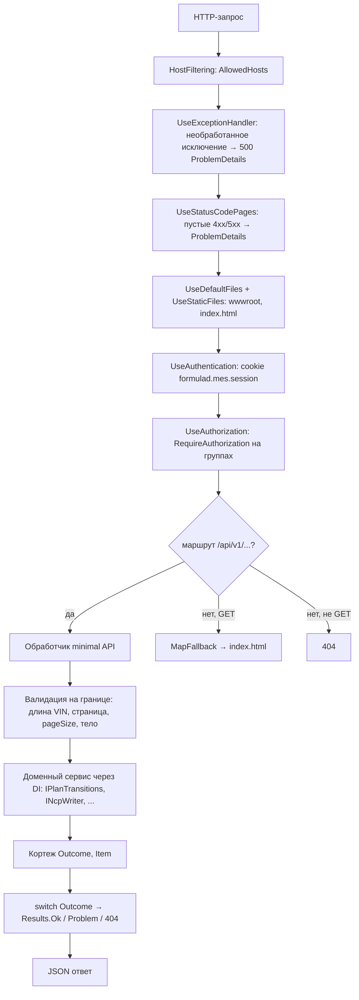

# 05. Руководство по бэкенду

| | |
|---|---|
| **Назначение** | Объяснить устройство бэкенда: структура проекта, сборка зависимостей, жизненный цикл запроса, SQL-сервисы, конфигурация, и дать пошаговые рецепты типовых доработок. |
| **Для кого** | Разработчик, который впервые открыл `src/FormulaD.Mes.Api` и должен за час внести изменение. |
| **Проверено по коммиту** | `fc6f055` |
| **Связанные документы** | Модель и правила — [03](03-DOMAIN-MODEL.md); эндпоинты — [04](04-API-REFERENCE.md); данные и SQL — [06](06-DATA-AND-SQL.md). |

## Оглавление

1. [Технологии](#1-технологии)
2. [Структура проекта](#2-структура-проекта)
3. [Жизненный цикл запроса](#3-жизненный-цикл-запроса)
4. [Сборка зависимостей](#4-сборка-зависимостей)
5. [Пары интерфейс ↔ реализации](#5-пары-интерфейс--реализации)
6. [Состояние, конкурентность, соединения](#6-состояние-конкурентность-соединения)
7. [Ошибки и валидация](#7-ошибки-и-валидация)
8. [Журнал событий](#8-журнал-событий)
9. [Конфигурация](#9-конфигурация)
10. [Аутентификация](#10-аутентификация)
11. [Тесты](#11-тесты)
12. [Рецепты](#12-рецепты)
13. [Соглашения проекта](#13-соглашения-проекта)
14. [Известные проблемы и технический долг](#14-известные-проблемы-и-технический-долг)

---

## 1. Технологии

| Что | Версия / решение | Источник |
|---|---|---|
| Платформа | .NET 10 (`net10.0`), ASP.NET Core **Minimal API** (одна точка входа `Program.cs`, без контроллеров) | [`FormulaD.Mes.Api.csproj`](../../src/FormulaD.Mes.Api/FormulaD.Mes.Api.csproj) |
| Доступ к SQL Server | `Microsoft.Data.SqlClient` 7.1.1, **чистый ADO.NET** (`SqlCommand`, параметры), ORM нет | csproj, `Sql*.cs` |
| Аутентификация | Cookie-аутентификация ASP.NET Core, dev-вход по настройке | `Program.cs` |
| OpenAPI | `Microsoft.AspNetCore.OpenApi` 10.0.14, включён только в Development | `Program.cs` |
| Windows Service | `Microsoft.Extensions.Hosting.WindowsServices` (`builder.Host.UseWindowsService()`) | `Program.cs`, [`../../deploy/install-service.bat`](../../deploy/install-service.bat) |
| Тесты | xUnit 2.9.2, `Microsoft.AspNetCore.Mvc.Testing` 10.0.0 | [`FormulaD.Mes.Api.Tests.csproj`](../../tests/FormulaD.Mes.Api.Tests/FormulaD.Mes.Api.Tests.csproj) |
| Секреты | `UserSecretsId = formulad-mes2-api` | csproj |

Модели — неизменяемые `record` с позиционными параметрами; изменение состояния — копия `with { ... }`. Блокировки — `System.Threading.Lock` (C# 13).

## 2. Структура проекта

```text
formulad-mes2/
├─ src/FormulaD.Mes.Api/        сам API (один проект, плоская структура файлов)
├─ tests/FormulaD.Mes.Api.Tests/  интеграционные и юнит-тесты (xUnit)
├─ fixtures/                    тестовые данные (JSON) — копируются в bin при сборке
├─ sql/                         административные скрипты для TEST-базы (запускает человек)
├─ deploy/                      пример production-конфига и установщик службы Windows
├─ stand/                       скрипт тестового стенда (stand.sh)
├─ apps/web/                    React-фронтенд (см. 07-FRONTEND-GUIDE)
└─ docs/                        требования, контракты, отчёты и этот справочник
```

Файлы бэкенда (все в [`src/FormulaD.Mes.Api`](../../src/FormulaD.Mes.Api/)):

| Файл | Что внутри |
|---|---|
| `Program.cs` | **Корень композиции и все маршруты.** Регистрация SQL-сервисов, аутентификация, middleware, 44 эндпоинта, вспомогательные функции `Problem`, `StatusLabel`, `IsLoopback`, `IsSameOrigin` |
| `Models.cs` | `ProductionPlanItem`, `PagedResult<T>`, `ProductionPlanQuery`, `DevAuthOptions`, запросы `MoveRequest`, `SetCheckRequest`, `DevAuthLoginRequest` |
| `IProductionPlanReader.cs` | Чтение плана: страница, по VIN, список статусов |
| `IPlanOrderEditor.cs` | Перестановка очереди + `MoveOutcome` |
| `PlanTransitions.cs` | `IPlanTransitions` (5 переходов) + `TransitionOutcome` |
| `JobCardPrinter.cs` | `IJobCardPrinter` — отметка печати |
| `VinSearch.cs` | Правило «только цифры — по хвосту, иначе по началу» |
| `Ncp.cs` | Сущности NCP, `INcpReader`/`INcpWriter`, **`DemoNcpStore`** (in-memory test double) |
| `StationChecks.cs` | `ComponentCheck`, `IStationChecks`, **`DemoStationChecks`** (in-memory test double) |
| `PlanImport.cs` | Типы импорта, `IPlanImport`, `IPlanPublisher`, **`DemoPlanImport`** (in-memory test double) |
| `IncomingInspection.cs` | Типы входного контроля, `IIncomingInspectionReader/Writer`, **`DemoIncomingInspectionStore`** (in-memory test double) |
| `EventLog.cs` | `IEventLog` + `InMemoryEventLog` |
| `DemoProductionPlanReader.cs` | In-memory test double, реализующий **пять интерфейсов** (чтение, порядок, переходы, печать, публикация) на списке в памяти |
| `SqlOptions.cs` | Настройки SQL-подключения |
| `ProductionPlanSql.cs` | Тексты SELECT для плана (белый список колонок, пагинация, LIKE) |
| `SqlProductionPlanReader.cs` | SQL-чтение плана |
| `SqlPlanTransitions.cs`, `SqlPlanOrderEditor.cs`, `SqlJobCardPrinter.cs`, `SqlPlanPublisher.cs` | SQL-запись плана |
| `SqlNcpStore.cs`, `SqlStationChecks.cs`, `SqlPlanImport.cs`, `SqlIncomingInspection.cs` | SQL-варианты остальных модулей |

Именование: интерфейс (`IFoo`) и in-memory реализация (test double) лежат в **одном файле** с моделями области (`Ncp.cs`, `PlanImport.cs`…); SQL-реализация — в отдельном файле `SqlFoo.cs`.

## 3. Жизненный цикл запроса

Порядок middleware в `Program.cs` (важен):



Что делает обработчик, на примере `POST /production-plan/{vin}/fok` (`Program.cs`):

1. Привязка параметров: `vin` из пути, сервисы из DI, `ClaimsPrincipal user` из аутентификации.
2. Проверка длины VIN → 400.
3. Проверка **вне домена**: `INcpReader.GetMissingRequiredPartsAsync` → 400, если есть блокирующие NCP.
4. Вызов `IPlanTransitions.FokAsync(vin, user.Identity?.Name ?? "неизвестно", ct)` → `(TransitionOutcome, ProductionPlanItem?)`.
5. `switch` по исходу: `Ok` → `Results.Ok(item)`, `VinNotFound` → 404, иначе → 400 с текстом про статус.

Группы маршрутов: `var plan = api.MapGroup("/production-plan").RequireAuthorization();` — авторизация наследуется всеми маршрутами группы. Анонимны только `health/live` (`.AllowAnonymous()`) и `dev-auth/login`.

## 4. Сборка зависимостей

Единственный источник данных — SQL Server. `SqlOptions.Create(configuration)` проверяет наличие строки подключения и регистрируется как одиночка. Остальные сервисы создаются **фабриками** от `SqlOptions` (`sp => new SqlFoo(sp.GetRequiredService<SqlOptions>())`) либо сразу (`new SqlNcpStore(sqlOptions, eventLog)`):

```text
SqlProductionPlanReader   → IProductionPlanReader
SqlPlanTransitions        → IPlanTransitions
SqlPlanOrderEditor        → IPlanOrderEditor
SqlJobCardPrinter         → IJobCardPrinter
SqlPlanPublisher          → IPlanPublisher
SqlNcpStore               → INcpReader, INcpWriter
SqlStationChecks          → IStationChecks
SqlPlanImport             → IPlanImport          // получает IProductionPlanReader и IPlanPublisher из DI
SqlIncomingInspection     → IIncomingInspectionReader, IIncomingInspectionWriter
InMemoryEventLog          → IEventLog            // журнал только в памяти
```

> `IEventLog` — `InMemoryEventLog`. Записи теряются при перезапуске.

In-memory реализации (`DemoProductionPlanReader`, `DemoNcpStore` и др.) сохранены в кодовой базе и используются **только в тестах** как test doubles, подключаемые через `ConfigureTestServices` в `ApiFactory` (см. [раздел 11](#11-тесты)).

## 5. Пары интерфейс ↔ реализации

| Интерфейс | SQL-реализация | Test double (in-memory) | Примечания |
|---|---|---|---|
| `IProductionPlanReader` | `SqlProductionPlanReader` | `DemoProductionPlanReader` | `PlannedCompleteDate` в SQL берётся из `PlannedShipmentDate` |
| `IPlanOrderEditor` | `SqlPlanOrderEditor` | `DemoProductionPlanReader` | В SQL — одна транзакция, `WriteConnectionString` |
| `IPlanTransitions` | `SqlPlanTransitions` | `DemoProductionPlanReader` | В SQL — `UPDATE … WHERE [statusid]=@from`, дополнительно пишет `reworkdate`/`reworkcompletedate` |
| `IJobCardPrinter` | `SqlJobCardPrinter` | `DemoProductionPlanReader` | `UPDATE [PrintDate]` |
| `IPlanPublisher` | `SqlPlanPublisher` | `DemoProductionPlanReader` | SQL: `INSERT` в транзакции, `PlannedCompleteDate` не вставляется |
| `INcpReader` / `INcpWriter` | `SqlNcpStore` | `DemoNcpStore` | **Принципиально разные правила** (признак установки детали, FOK-блок) — [03 §6.1](03-DOMAIN-MODEL.md#61-ncp-признак-установки-детали) |
| `IStationChecks` | `SqlStationChecks` | `DemoStationChecks` | SQL: `MERGE` в `tblComponentCheck`, таблица создаётся приложением |
| `IPlanImport` | `SqlPlanImport` | `DemoPlanImport` | Одинаковая валидация; справочники — `DISTINCT` из `tblProductionPlan`; сессии в памяти |
| `IIncomingInspectionReader` / `Writer` | `SqlIncomingInspection` | `DemoIncomingInspectionStore` | SQL создаёт 5 таблиц сам |
| `IEventLog` | `InMemoryEventLog` | та же | — |

**Правило поддержки.** Интерфейс — единственный контракт. Любое изменение сигнатуры, исхода (`enum`) или правила нужно вносить в SQL-реализацию и в test double; SQL-реализация автоматических интеграционных тестов не имеет (нужна живая TEST-база), поэтому её проверяют руками на TEST и покрывают юнит-тестами текстов запросов, где они вынесены (`ProductionPlanSql`).

## 6. Состояние, конкурентность, соединения

**SQL.**

- **Новое соединение на каждый вызов** (`new SqlConnection(...)`, `OpenAsync`, `await using`); настройка пула — по умолчанию драйвера.
- Две строки: `ConnectionString` (чтение, `ApplicationIntent=ReadOnly`) и `WriteConnectionString` (запись, без этого намерения). **Логин в обеих один и тот же** (из `Sql:ConnectionString`): намерение ReadOnly — лишь подсказка маршрутизации, а не ограничение прав ([06](06-DATA-AND-SQL.md#4-два-подключения-и-права)).
- Атомарность: переходы — один `UPDATE` с условием по статусу; перестановка и публикация — явная транзакция с откатом при исключении.
- Автосоздание таблиц: `SqlStationChecks` и `SqlIncomingInspection` при первом обращении выполняют `CREATE TABLE IF NOT EXISTS`-блок; признак `volatile bool _tableEnsured` защищает от повторов.
- Таймаут команд — `Sql:CommandTimeoutSeconds` (по умолчанию 15).

## 7. Ошибки и валидация

Три уровня, от внешнего к внутреннему:

1. **Граница HTTP (`Program.cs`).** Простые синтаксические проверки: длина VIN 1..50, `page ≥ 1`, `pageSize 1..100`, непустой комментарий для `quota`/`reopen`, число строк импорта 1..500, `toPosition ≥ 1`. Ответ — `Problem(title, detail)` → **400**.
2. **Домен (хранилища).** Бизнес-проверки возвращают **исход**, а не бросают исключения: `(TransitionOutcome Outcome, ProductionPlanItem? Item)`, `MoveOutcome`, `CreateNcpOutcome`, `RowResultOutcome` и т. д. Объект исхода показывает, **почему** отказ.
3. **Перевод исхода в HTTP (`Program.cs`).** `switch` по enum → `Results.Ok(...)`, `Results.Problem(... 404)`, `Problem(...)` (400). Тексты ошибок — на русском, в самом `Program.cs`.

Исключения означают сбой инфраструктуры (потеряна БД) и превращаются в 500 общим обработчиком.

**Как добавить новый исход.** Добавьте значение в `enum` → верните его из SQL-реализации и test double → добавьте ветку в `switch` в `Program.cs`. Если забыть ветку, исход уйдёт в `_ =>` и вернётся как вводящее в заблуждение сообщение: в `Program.cs` почти везде последняя ветка — «общий» отказ (например, для `QuotaOutcome` `_` означает «Некорректный объём»).

## 8. Журнал событий

```csharp
eventLog.Record("Ncp", number, "Close", "Открыто", "Закрыто", userName);
```

- `entityType` и `action` — свободные строки (список используемых значений — [03 §5](03-DOMAIN-MODEL.md#5-журнал-событий)).
- Запись делается **после** успешного изменения.
- `InMemoryEventLog` ограничения по размеру не имеет.
- **Чтения через API нет** (`IEventLog.Query` вызывается только из тестов). Чтобы показать журнал, нужен новый маршрут и, для долговечности, SQL-реализация `IEventLog`.

## 9. Конфигурация

Конфигурация — стандартная иерархия ASP.NET Core: `appsettings.json` → `appsettings.{Environment}.json` → user-secrets (только Development) → переменные окружения → аргументы командной строки. В переменных окружения двоеточие заменяется на `__` (например, `DevAuth__Enabled`).

| Ключ | Назначение | Умолчание | Где используется |
|---|---|---|---|
| `Sql:ConnectionString` | Строка подключения к SQL Server | нет → ошибка запуска | `SqlOptions.Create` |
| `Sql:CommandTimeoutSeconds` | Таймаут команды | `15` | `SqlOptions.Create` |
| `DevAuth:Enabled` | Включить dev-вход | `false` | `Program.cs` (**учитывается только в `Development`**) |
| `DevAuth:Username`, `DevAuth:Password` | Учётные данные dev-входа | нет (пароля по умолчанию нет) | `Program.cs` |
| `AllowedHosts` | Разрешённые значения `Host` | `localhost;127.0.0.1;[::1]` | `appsettings.json`, платформа |
| `ASPNETCORE_ENVIRONMENT` | Окружение | `Development` в `launchSettings.json` | платформа |
| `ASPNETCORE_URLS` / `--urls` | Адрес | `http://localhost:5080` (профиль `http`) | платформа |

Пример запуска (из `formulad-mes2/src/FormulaD.Mes.Api`):

```bash
DevAuth__Enabled=true DevAuth__Username=demo-operator DevAuth__Password=<локальный пароль> \
ASPNETCORE_ENVIRONMENT=Development dotnet run --no-launch-profile --urls http://localhost:5080
```

Секреты разработчика хранятся через `dotnet user-secrets` (проект с `UserSecretsId`):

```bash
dotnet user-secrets set "DevAuth:Password" "<локальный пароль>" --project src/FormulaD.Mes.Api
```

Быстрый путь для тестового стенда — [`../../stand/stand.sh`](../../stand/stand.sh) (подробности в `README.md`).

> **Расхождение с `deploy/appsettings.Production.example.json`.** Пример предполагает `DevAuth.Enabled=true` в production-конфиге, но `DevAuthOptions.Enabled` в коде равно `DevAuth:Enabled && IsDevelopment()`. Вне `Development` dev-вход не работает, маршрут не регистрируется, и все защищённые эндпоинты отвечают 401. То есть сервис, установленный `install-service.bat` по этому примеру, будет закрыт для всех. Рабочей production-аутентификации в коде нет (security-документ прямо: «система закрыта, пока не согласован ID-провайдер»). Кроме того, пример содержит строку подключения с логином `mes_writer` и `Password=CHANGE_ME`; реальные значения в репозиторий не коммитятся.

## 10. Аутентификация

- Схема: `CookieAuthenticationDefaults.AuthenticationScheme`, имя cookie `formulad.mes.session`, `HttpOnly`, `SameSite=Strict`, `Secure` вне Development, срок 8 ч, `SlidingExpiration`.
- Редиректы отключены: `OnRedirectToLogin` → 401, `OnRedirectToAccessDenied` → 403.
- `POST /dev-auth/login` существует **только если** `devAuth.CanLogIn` (`Enabled` и включён `Development` и оба секрета заданы). При старте без возможности входа в лог пишется предупреждение (без значений секретов).
- Вход: loopback-клиент + `Origin` пуст или локальный. Claims: `Name=<username>`, `auth_mode=dev`.
- В обработчиках имя пользователя берётся из `ClaimsPrincipal.Identity.Name`; ролей и политик нет.

## 11. Тесты

Команда: `dotnet test` из `formulad-mes2` (в проекте тестов 127 тестов).

**Базовая фабрика — [`ApiFactory`](../../tests/FormulaD.Mes.Api.Tests/ApiFactory.cs).** Поднимает приложение в памяти (`WebApplicationFactory<Program>`) с in-memory test doubles через `ConfigureTestServices`, окружение `Development`, `DevAuth:Enabled` по параметру, логин `demo-operator` и пароль `test-only-secret` (константы только для тестов). Фабрика задаёт фиктивную строку подключения SQL и подменяет все сервисы данных на `DemoProductionPlanReader`, `DemoNcpStore` и т.д. `CreateAuthenticatedClientAsync()` возвращает клиент с cookie-сессией после реального `POST /dev-auth/login`. Каждый тест создаёт **свою фабрику** (изолированное состояние), `reloadConfigOnChange=false` защищает от лимита inotify в песочнице.

Шаблон теста:

```csharp
[Fact]
public async Task Something_Works()
{
    using var factory = new ApiFactory(devAuthEnabled: true);
    var client = await factory.CreateAuthenticatedClientAsync();
    var response = await client.PostAsync("/api/v1/production-plan/DEMO-VIN-00003/fok", null);
    response.EnsureSuccessStatusCode();
}
```

| Файл | Тестов | Что покрывает |
|---|---|---|
| `ApiTests.cs` | 19 | Health анонимен; 401 без входа; отсутствие dev-login при выключенной настройке; список, сортировка по `SEQN`, фильтры VIN/статус/`statusId`, NULL-статус, карточка и 404, невалидная пагинация, длинный VIN; отсутствие PUT/PATCH/DELETE на карточке; даты без суффикса зоны; класс `MoveTests` (перестановка) |
| `StartTests.cs`, `CompleteTests.cs`, `FokTests.cs`, `ReworkTests.cs` | 7 / 6 / 8 / 8 | Переходы статусов и блокировки |
| `LifecycleTests.cs` | 9 | Сквозной путь start→complete→FOK, Rework→FOK, `auth/me`, logout, 404 для неизвестной поставки/коробки, повторный start |
| `NcpTests.cs` | 13 | Список, создание, валидации, «деталь установлена», закрытие |
| `StationChecksTests.cs` | 8 | Отметки проверки |
| `PlanImportTests.cs` | 11 | Проверка строк, исправление, публикация |
| `IncomingInspectionTests.cs` | 18 | Поставка, Packing List, результаты, норматив, закрытие/переоткрытие |
| `JobCardPrintTests.cs` | 5 | Отметка печати |
| `EventLogTests.cs` | 3 | `InMemoryEventLog` напрямую |
| `SqlReaderTests.cs` | 12 | Класс `ProductionPlanSqlTests`: свойства текстов SELECT (без `*`, без `NOLOCK`, параметры, белый список колонок, правило LIKE); валидация `SqlOptions` |

Чего нет: автотестов SQL-реализаций против живой базы; тестов фронтенда здесь нет (они в `apps/web`, vitest).

## 12. Рецепты

### 12.1. Добавить эндпоинт

Пример: `GET /api/v1/ncp/summary?vin=…` — количество открытых и закрытых NCP по изделию.

1. **Тип ответа.** В [`Ncp.cs`](../../src/FormulaD.Mes.Api/Ncp.cs) добавьте `public sealed record NcpSummary(int Open, int Closed);`.
2. **Контракт.** Добавьте метод в нужный интерфейс (`INcpReader`): `Task<NcpSummary> GetSummaryAsync(string vin, CancellationToken ct);`.
3. **SQL.** Реализуйте в `SqlNcpStore`: параметризованный `SELECT` (только параметры, без конкатенации значений), `new SqlConnection(options.ConnectionString)`, `CommandTimeout = options.CommandTimeoutSeconds`. Для чтения используйте `ConnectionString`, для изменения — `WriteConnectionString`.
4. **Test double.** Реализуйте в `DemoNcpStore` под `lock (_gate)`: посчитайте по `_items.Value`.
5. **Маршрут.** В `Program.cs` внутри группы `ncp` (она уже `RequireAuthorization`):
   ```csharp
   ncp.MapGet("/summary", async (string vin, INcpReader reader, CancellationToken ct) =>
   {
       if (string.IsNullOrWhiteSpace(vin) || vin.Length > 50)
           return Problem("Некорректный VIN", "VIN должен содержать от 1 до 50 символов.");
       return Results.Ok(await reader.GetSummaryAsync(vin, ct));
   });
   ```
   Литеральные сегменты (`/summary`) объявляйте до параметризованных (`/{id:int}`), чтобы не нарушить приоритет.
6. **Клиент.** В [`apps/web/src/api.ts`](../../apps/web/src/api.ts) добавьте тип и метод в объект `api`.
7. **Тесты.** В новый или существующий файл тестов: (а) без входа → 401; (б) успешный сценарий на test double (в `ncp.demo.json` у `DEMO-VIN-00001` две открытые NCP); (в) невалидный VIN → 400.
8. **Документация.** Строка в [04-API-REFERENCE.md](04-API-REFERENCE.md); если маршрут пишет данные — правило в [03](03-DOMAIN-MODEL.md) и запись в журнал событий ([раздел 8](#8-журнал-событий)).

Для **записывающего** эндпоинта дополнительно: определите `enum` исхода, верните его из SQL-реализации и test double, разберите в `switch` в `Program.cs`; пишите в журнал; дайте SQL-логину право на нужную колонку в [`sql/create-writer-login.sql`](../../sql/create-writer-login.sql).

### 12.2. Добавить поле в сущность

Пример: `Notes` (текст, nullable) у `ProductionPlanItem`.

1. **Модель.** В [`Models.cs`](../../src/FormulaD.Mes.Api/Models.cs) добавьте **в конец** позиционного списка с умолчанием: `string? Notes = null`. Значение по умолчанию сохраняет совместимость с фикстурами без этого поля (десериализация записей использует основной конструктор) и с существующими вызовами.
2. **SQL, чтение.** В [`ProductionPlanSql.Columns`](../../src/FormulaD.Mes.Api/ProductionPlanSql.cs) добавьте `[Notes]` (белый список колонок: **никакого `SELECT *`**) и прочитайте в `SqlProductionPlanReader.Map` через `GetNullableString(reader, "Notes")`.
4. **SQL, запись.** Если поле редактируется — добавьте его в соответствующий `UPDATE`/`INSERT` (`SqlPlanTransitions`, `SqlPlanPublisher`…) и выдайте `GRANT UPDATE ON [dbo].[tblProductionPlan] ([Notes])` в `sql/create-writer-login.sql`.
5. **Тесты.** Обновите `Column_Whitelist_Excludes_Rowversion_And_Noise_Columns` в `SqlReaderTests.cs` (добавьте `Assert.Contains("[Notes]", ...)`) и, если нужно, тест вокруг эндпоинта.
6. **Фронтенд.** Поле в типе `ProductionPlanItem` в `api.ts`; для таблицы плана — запись в `COLUMNS` ([`columns.ts`](../../apps/web/src/columns.ts)).
7. **Документация.** [`../DB_CONTRACT.md`](../DB_CONTRACT.md) и таблица полей в [03](03-DOMAIN-MODEL.md).

Для других сущностей (`NcpItem`, `Package` и т. д.) схема та же: маппер в SQL, test double (`CreateAsync` и фикстура), `api.ts`. У `NcpItem` и сущностей входного контроля новое поле, которого нет в JSON-фикстуре, **молча получит `default`** (`0`, `false`, `null`) — `System.Text.Json` не падает на отсутствующих параметрах конструктора. Поэтому добавляйте поле и в фикстуры, иначе тестовые данные будут тихо неполными.

### 12.3. Добавить правило перехода

**А. Новый разрешённый переход** (пример: прямой `1 → 4`, закрытый вопрос В-07).

1. **Контракт.** Новый метод в `IPlanTransitions` ([`PlanTransitions.cs`](../../src/FormulaD.Mes.Api/PlanTransitions.cs)), например `SendToReworkFromWorkAsync`. Исход — уже существующий `TransitionOutcome`.
2. **SQL.** В `SqlPlanTransitions`: `TransitionAsync(vin, fromStatusId: 1, toStatusId: 4, "rework", "reworkdate", "SendToReworkFromWork", userName, ct)`. Убедитесь, что колонка даты входит в `GRANT UPDATE` в `sql/create-writer-login.sql`.
4. **Маршрут.** В блоке переходов `Program.cs`: `plan.MapPost("/{vin}/…", …)` по образцу `rework`: проверка длины VIN → вызов → `switch` по исходу, текст ошибки с `StatusLabel(...)`.
5. **Клиент и UI.** Метод в `api.ts`, кнопка на экране.
6. **Тесты.** Класс по образцу [`ReworkTests.cs`](../../tests/FormulaD.Mes.Api.Tests/ReworkTests.cs): 401 без входа; успех; отказ из неверного статуса **с проверкой, что статус не изменился**; 404 для неизвестного VIN.
7. **Документация.** Диаграмма и таблица переходов в [03 §3](03-DOMAIN-MODEL.md#3-статусы-изделия-и-переходы), спецификация (раздел 5, 10).

**Б. Дополнительная проверка существующего перехода** (как блокировка FOK): положите проверку в **обработчик** перед вызовом `IPlanTransitions`, как сделано для `fok` и `rework/finish`. Сам `IPlanTransitions` намеренно ничего не знает про другие модули. Вынесите проверку в интерфейс соседнего модуля (как `INcpReader.GetMissingRequiredPartsAsync`), реализуйте в SQL и test double, добавьте тесты на «отказ не меняет статус».

**В. Изменить правило блокировки FOK** (например, учитывать признак «обязательная»): правка в `DemoNcpStore.GetMissingRequiredPartsAsync` **и** `SqlNcpStore.GetMissingRequiredPartsAsync` (в SQL для этого потребуется новая колонка, см. [03 §6.1](03-DOMAIN-MODEL.md#61-ncp-признак-установки-детали)), тесты `FokTests.cs`, `NcpTests.cs`.

### 12.4. Добавить тестовую фикстуру

1. Положите файл в `fixtures/` (имя `*.demo.json`).
2. **Обязательно** добавьте его в [`FormulaD.Mes.Api.csproj`](../../src/FormulaD.Mes.Api/FormulaD.Mes.Api.csproj) строкой `<Content Include="../../fixtures/…" CopyToOutputDirectory="PreserveNewest" Link="fixtures/…" />` — иначе файла не окажется в каталоге вывода и тесты не найдут данных.
3. Читайте через `Load<T>(path)` (как в `DemoNcpStore`), путь — `Path.Combine(AppContext.BaseDirectory, "fixtures", "…")`.

### 12.5. Сделать модуль, требующий новую таблицу SQL

Существующий подход (модули «станции» и «входной контроль»): приложение создаёт таблицы само при первом обращении (`EnsureTable(s)Async`, блок `IF OBJECT_ID(...) IS NULL CREATE TABLE`). Это упрощает TEST, но **требует прав DDL у логина** и непригодно для PROD с управляемыми миграциями. Для нового модуля сначала решите, нужен ли файл миграции в `sql/` вместо автосоздания. В любом случае: выдайте права в `create-writer-login.sql`, обновите [06](06-DATA-AND-SQL.md).

## 13. Соглашения проекта

- **Язык.** Тексты ошибок и комментарии — русские; идентификаторы — английские.
- **Ссылки на требования.** В комментариях номера разделов спецификации (`раздел 16`), метки согласованности: **[С]** — согласовано, **[П]** — проектная детализация, **[В]** / `В-NN` — открытый вопрос из реестра (`docs/SPECIFICATION.md`, разделы 30–31).
- **Метка `ponytail:`.** Осознанное упрощение с известным пределом: рядом указан предел и путь апгрейда (например, «одна блокировка на список», «MAX(SEQN)+1»). Не удаляйте её, не поняв предела; меняя код — обновляйте комментарий.
- **Fail-closed.** Неполная или подозрительная конфигурация не должна запускаться и не должна подменяться запасным вариантом.
- **SQL.** Только параметры; явный белый список колонок; без `NOLOCK`; пагинация `OFFSET/FETCH`; значения пользователя в текст запроса не подставляются (имя колонки даты в `SqlPlanTransitions.TransitionAsync` берётся из литералов в коде, а не от пользователя).
- **Нет скрытых побочных эффектов.** Изменяющий метод возвращает итоговое состояние и пишет в журнал.

## 14. Известные проблемы и технический долг

Найдено при составлении справочника; все пункты подтверждены кодом.

| # | Проблема | Где | Риск |
|---|---|---|---|
| 1 | В SQL-режиме одна строка подключения служит и для чтения, и для записи; логин «только SELECT» (по README) не сможет выполнять переходы, NCP, импорт | `SqlOptions.Create` | Либо записи не работают, либо логину дают лишние права |
| 2 | Автосоздание таблиц требует DDL-прав у того же логина | `SqlStationChecks`, `SqlIncomingInspection` | Противоречит принципу минимальных прав |
| 3 | В SQL нет признака «деталь установлена»; `SetPartInstalled` — no-op | `SqlNcpStore` | Раздел 16 спецификации не реализован в SQL |
| 4 | Комментарий инженера при закрытии NCP в SQL затирает комментарий оператора | `SqlNcpStore.CloseAsync` | Потеря данных |
| 5 | `PlannedCompleteDate` в SQL читается из `PlannedShipmentDate` и не вставляется при импорте | `SqlProductionPlanReader.Map`, `SqlPlanPublisher` | Неверные даты в UI |
| 6 | Журнал событий только в памяти и не читается через API | `EventLog.cs`, `Program.cs` | Нет прослеживаемости (раздел 25) |
| 7 | Сессии импорта и Packing List только в памяти | `SqlPlanImport`, оба хранилища входного контроля | Потеря при перезапуске |
| 8 | Блокировка FOK срабатывает на любую NCP без установленной детали, без признака «обязательная» | `GetMissingRequiredPartsAsync` | Расхождение с формулировкой раздела 16 |
| 9 | `POST /incoming-inspection/deliveries` без `invoiceNumber` даёт необработанное исключение (`Trim()` на `null`) | `SqlIncomingInspection` / test double | 500 вместо 400 |
| 10 | SQL: `MAX(SEQN)+1` внутри транзакции без блокировки | `SqlPlanPublisher.GetNextSeqnAsync` | Гонка при параллельной публикации (комментарий `ponytail:` допускает до 1000 строк) |
| 11 | Два справочника компонентов читают разные колонки `tblComponent`: `[StationID]` (NCP) и `[Station]` (входной контроль) | `SqlNcpStore`, `SqlIncomingInspection` | Одна из выборок, вероятно, неверна; сверить на TEST |
| 12 | Dev-аутентификация — единственный вход; пример production-конфига её включает, а код вне Development её отключает | `Program.cs`, `deploy/` | Развёрнутая служба недоступна |
| 13 | Ролевой модели нет | весь API | Любой вошедший выполняет любую операцию |
