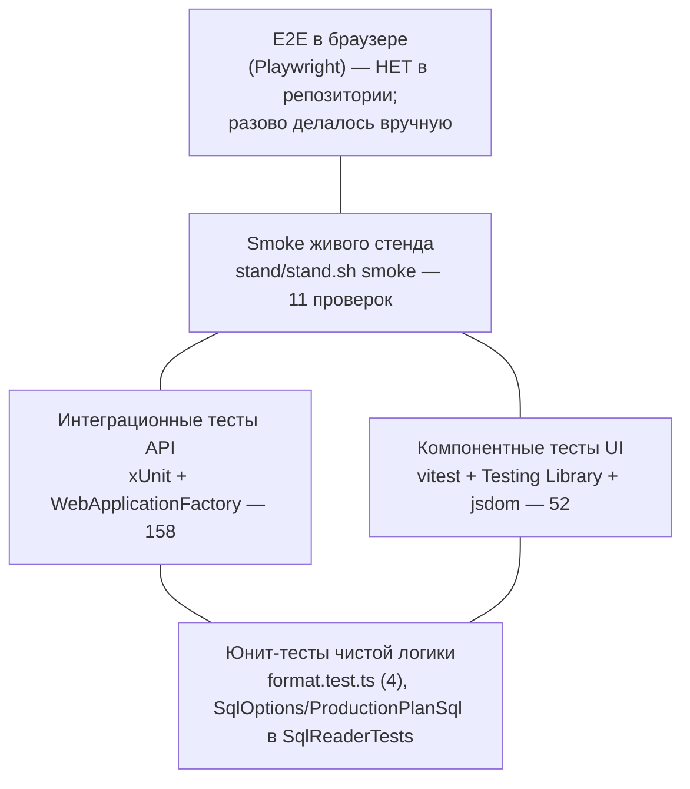

# 10. Тестирование

| | |
|---|---|
| **Назначение** | Как устроены, запускаются и пишутся тесты; что покрыто; где хрупко |
| **Для кого** | Разработчик перед первым коммитом; ревьюер |
| **Проверено по коммиту** | `fc6f055` (числа получены запуском в этой среде) |

## Оглавление

1. [Текущие числа](#1-текущие-числа)
2. [Пирамида тестов](#2-пирамида-тестов)
3. [Как запускать](#3-как-запускать)
4. [Backend: устройство и покрытие](#4-backend-устройство-и-покрытие)
5. [Frontend: устройство и покрытие](#5-frontend-устройство-и-покрытие)
6. [Как написать тест](#6-как-написать-тест)
7. [Соглашения](#7-соглашения)
8. [Хрупкие места и известные ограничения](#8-хрупкие-места-и-известные-ограничения)

---

## 1. Текущие числа

Получено запуском на коммите `fc6f055` (Linux, .NET SDK 10, Node 22):

| Набор | Команда | Результат |
|---|---|---|
| Backend (xUnit) | `dotnet test tests/FormulaD.Mes.Api.Tests` | **158 пройдено, 0 упало, 0 пропущено** (≈15 с) |
| Frontend (vitest) | `cd apps/web && npx vitest run` | **77 пройдено** в **18 файлах** (≈10 с) |
| Типы | `cd apps/web && npx tsc -b` | без ошибок |
| Сборка UI | `cd apps/web && npm run build` | успешно (`tsc -b && vite build`) |
| Стенд | `./stand/stand.sh smoke` | 11 проверок живого стенда |

> `docs/IMPLEMENTATION_REPORT.md` называет **149** backend-тестов — число устарело (с тех пор тестов стало 158).

## 2. Пирамида тестов



Основная масса — интеграционные тесты API (запрос → ответ через настоящий конвейер ASP.NET, но с Demo-данными) и компонентные
тесты экранов (с подменой `fetch`). Автоматизированных E2E-тестов в браузере **нет**; CI (GitHub Actions для MES) **не настроен**
(единственный workflow в репозитории — `.github/workflows/cron.yml` — относится к постороннему проекту).

## 3. Как запускать

```bash
# Backend — из formulad-mes2/
dotnet test tests/FormulaD.Mes.Api.Tests
dotnet test tests/FormulaD.Mes.Api.Tests --filter "FullyQualifiedName~FokTests"   # один класс
dotnet test tests/FormulaD.Mes.Api.Tests --filter "Name~Fok_Is_Blocked"           # один тест

# Frontend — из formulad-mes2/apps/web/
npx vitest run                         # всё, один прогон
npx vitest run src/FokScreen.test.tsx  # один файл
npx vitest                             # режим наблюдения
npx tsc -b                             # проверка типов
npm run build                          # tsc -b && vite build
```

Тесты не требуют SQL Server, Access, сети и секретов. `dotnet test` собирает в `Debug`, стенд работает на `Release` — они
не мешают друг другу (общий только каталог `wwwroot`, который тесты не используют).

**Перед коммитом выполните оба набора и `tsc -b`.** Запуск только отдельных файлов уже приводил к пропущенным поломкам
(редизайн FOK незаметно сломал 5 тестов, пока не прогнали всё).

## 4. Backend: устройство и покрытие

Проект `tests/FormulaD.Mes.Api.Tests` (xUnit 2.9, `Microsoft.AspNetCore.Mvc.Testing`, ссылка на проект API;
`InternalsVisibleTo` открыт для тестов).

### 4.1. Фабрики приложения

| Фабрика | Что делает | Для чего |
|---|---|---|
| `ApiFactory(devAuthEnabled)` | Поднимает API **в памяти**: `Development`, Demo-источник, фикстура плана по относительному пути `../../../../../fixtures`, DevAuth с логином `demo-operator` и паролем `test-only-secret` | Почти все тесты; `CreateAuthenticatedClientAsync()` выполняет dev-вход и возвращает клиент с cookie-сессией (свой `CookieHandler`) |
| `SqlAttemptFactory(dataSource)` | Запускает приложение в режиме `Sql` **без** обязательных настроек | Проверка fail-closed: старт должен падать, а не подключаться |
| `SqlConfiguredFactory` | Режим `Sql` с корректной по форме конфигурацией (`Database=FormulaD_TEST`, фиктивный хост), реального подключения не происходит | Проверка набора маршрутов в SQL-режиме: запрос без входа должен вернуть `401` (а не `404`) — значит, маршрут существует |

Каждый тест создаёт **собственную** фабрику (`using var factory = new ApiFactory(...)`): демо-состояние живёт в памяти процесса
и мутируется, поэтому изоляция — по экземпляру фабрики. Отключено `hostBuilder:reloadConfigOnChange` — иначе каждая фабрика
заводит `FileSystemWatcher`, и на десятках тестов упираются в лимит `inotify` (128 в песочнице).

### 4.2. Покрытие по файлам

(в скобках — число методов `[Fact]/[Theory]`; `[Theory]` раскрываются в несколько случаев, поэтому сумма 127 < 158)

| Файл | Тестов | Что проверяет |
|---|---|---|
| `ApiTests.cs` | 19 | `401` без входа на бизнес-GET; отсутствие dev-login при выключенном режиме; неверный пароль; пагинация/сортировка; поиск VIN; фильтр статуса; `null`-статусы; карточка и `404`; `400` на page/pageSize/длинный VIN; запись в `/production-plan` не разрешена (`Write_Methods_On_Production_Data_Are_Not_Allowed`); даты без зоны; fail-closed для `Sql` без маркера TEST и неизвестного `DataSource`; перестановка (`Move_*`: соседний обмен, дальний сдвиг, авторизация, плохой ввод) |
| `LifecycleTests.cs` | 9 | сквозные пути: Старт→Завершение→FOK и Rework→FOK; `GET /auth/me`, выход (в т.ч. без сессии); `404` для неизвестных поставок/коробок; повторный Старт не меняет статус |
| `StartTests.cs` | 7 | запуск `0→1`: авторизация, статус, повторный запуск, `404`, длина VIN |
| `CompleteTests.cs` | 6 | завершение `1→2`; **не** блокируется NCP; маршрут существует в SQL-режиме |
| `FokTests.cs` | 8 | `2→3`; блокировка деталью; `GET /ncp/missing-parts`; маршрут в SQL-режиме |
| `ReworkTests.cs` | 8 | `2→4`, `4→2` с повторной проверкой детали |
| `NcpTests.cs` | 13 | список/фильтры, регистрация, «деталь установлена», «закрыть», валидация, раздельные состояния |
| `StationChecksTests.cs` | 8 | отметки проверки по станциям, массовые операции, связь с NCP |
| `PlanImportTests.cs` | 11 | staging, построчная валидация (все ошибки сразу), правка строки, публикация в конец, запрет дублей |
| `IncomingInspectionTests.cs` | 18 | поставки, Packing List, коробки по HU, результаты, норматив, закрытие/повторное открытие |
| `JobCardPrintTests.cs` | 5 | отметка печати (`PrintDate`), статус не меняется |
| `EventLogTests.cs` | 3 | запись событий при операциях |
| `SqlReaderTests.cs` | 12 | **без SQL Server:** `SqlOptions` (флаг TEST, строка, запрещённые база/логины, `ReadOnly`, допустимость хоста `SQLACCESS` с базой TEST) и тексты запросов (`ProductionPlanSql`: параметры, `OFFSET/FETCH`, `[Status] IS NULL`, нет `SELECT *`/`NOLOCK`, белый список колонок, шаблоны `LIKE`, экранирование спецсимволов) |

**Не покрыто backend-тестами:** реальное выполнение `Sql*`-адаптеров против живой БД (нет SQL Server); конкурентность
(`AT-30`); идемпотентность повторных нажатий (`AT-29`); нагрузка; `EnsureTables`.

## 5. Frontend: устройство и покрытие

Стек: **vitest 2.1** (`environment: 'jsdom'`, `globals: true`), `@testing-library/react 16`, `@testing-library/user-event 14`,
`@testing-library/jest-dom` (подключён в `src/test-setup.ts`). Конфигурация — в `vite.config.ts` (раздел `test`).

**Приём:** `fetch` подменяется глобально функцией-маршрутизатором (`mockFetch(route)` определяется в начале каждого тестового
файла): она по `url` и `method` возвращает `{ status?, body? }`; неизвестный маршрут — `404`. Так экран тестируется целиком, с
настоящим `api.ts`, без сервера.

| Файл | Тестов | Что проверяет |
|---|---|---|
| `format.test.ts` | 4 | даты, статусы, подписи |
| `App.test.tsx` | 5 | вход, поиск VIN + Enter (сканер), карточка только для чтения (набор кнопок: «Печать», «NCP-лист»), «не найден» |
| `PlanScreen.test.tsx` | 4 | печать JobCard: флажки, двойной клик, «Выбрать первые 12», NCP-лист из карточки |
| `StartScreen.test.tsx` | 5 | механика скана, блокировка по статусу |
| `FokScreen.test.tsx` | 5 | блокировка по детали видна сразу, полный путь, «Отправить в Rework» |
| `ReworkScreen.test.tsx` | 4 | список NCP в карточке, завершение Rework |
| `StationScreen.test.tsx` | 5 | линия станций, отметки, «Зафиксировать расхождение» |
| `NcpScreen.test.tsx` | 5 | список, регистрация, действия |
| `ImportScreen.test.tsx` | 4 | вставка → ошибки → исправление → публикация |
| `IncomingInspectionScreen.test.tsx` | 5 | поставка, Packing List, коробки, результат |
| `JobCardDialog.test.tsx` | 5 | печатная карточка с QR |
| `ReportsScreen.test.tsx` | 1 | сводки по плану/NCP/входному контролю |

**Не покрыто:** `CompleteScreen` (отдельного файла нет; общий `ScanTransitionScreen` покрыт через Start/Rework), `AdminScreen`,
`LoginScreen` (частично через `App`), боковое меню и тема, анимации, печать на реальном принтере, визуальные регрессии.

## 6. Как написать тест

### Backend (шаблон)

```csharp
public sealed class MyFeatureTests
{
    [Fact]
    public async Task My_Endpoint_Requires_Authentication()
    {
        using var factory = new ApiFactory(devAuthEnabled: true);
        var response = await factory.CreateClient().PostAsync("/api/v1/production-plan/DEMO-VIN-00003/fok", null);
        Assert.Equal(HttpStatusCode.Unauthorized, response.StatusCode);
    }

    [Fact]
    public async Task My_Endpoint_Does_The_Thing()
    {
        using var factory = new ApiFactory(devAuthEnabled: true);
        var client = await factory.CreateAuthenticatedClientAsync();          // вход + cookie

        var response = await client.PostAsync("/api/v1/production-plan/DEMO-VIN-00003/fok", null);
        response.EnsureSuccessStatusCode();
        var item = await response.Content.ReadFromJsonAsync<ProductionPlanItem>();

        Assert.Equal(3, item!.StatusId);
    }
}
```

Что взять из тестовых фикстур: `DEMO-VIN-00001` (статус 1, два открытых NCP без детали), `…00002` (0), `…00003` (2, NCP закрыт — «чистый» для
FOK), `…00004` (3), `…00005` (без статуса), `…00006` (код `88`, `custom_unknown`). Таблицы фикстур — `06-DATA-AND-SQL`.

Для нового адаптера: добавьте тест, что **маршрут существует** (запрос без входа → `401`), и тест
текста запроса (параметры, белый список колонок), по образцу `SqlReaderTests`.

### Frontend (шаблон)

```tsx
import { render, screen } from '@testing-library/react';
import userEvent from '@testing-library/user-event';
import { vi, beforeEach, afterEach, it, expect } from 'vitest';

beforeEach(() => vi.restoreAllMocks());
afterEach(() => vi.unstubAllGlobals());

it('показывает изделие после скана', async () => {
  mockFetch((url) => {                               // функция-маршрутизатор из начала файла
    if (url.endsWith('/production-plan/DEMO-VIN-00003')) return { body: CLEAN };
    if (url.includes('/ncp/missing-parts')) return { body: [] };
    return undefined;                                // → 404
  });

  render(<FokScreen session={{ userName: 'demo-operator', mode: 'dev' }} onNavigate={() => {}} onLogout={() => {}} />);
  await userEvent.type(screen.getByLabelText('Сканирование VIN'), 'DEMO-VIN-00003{Enter}');

  await screen.findByLabelText('Найдено изделие DEMO-VIN-00003');
  expect(screen.getByRole('button', { name: 'Подтвердить FOK' })).toBeEnabled();
});
```

## 7. Соглашения

1. **Тестируем наблюдаемое поведение, а не вёрстку.** Элементы ищем по роли и доступному имени (`getByRole`, `getByLabelText`),
   не по классам CSS.
2. **Имена и подписи — часть контракта тестов.** Доступные имена (`aria-label`, текст кнопок) используются как селекторы:
   «Сканирование VIN», «Найдено изделие …», «Подтвердить FOK», «Печать», «NCP-лист», «Поиск VIN или сканирование».
   Меняя подпись — меняйте и тест (иначе он сломается, как уже случалось).
3. **Один тест — один факт**, имя описывает ожидаемое поведение (по-русски на фронте, `Method_Scenario` на бэкенде).
4. **Каждый backend-тест создаёт свою фабрику** (`using var factory`), без общего состояния между тестами.
5. **Для каждой операции записи** — тест «без входа → `401`», тест успеха, тест отказа по статусу/валидации.
6. **Никаких обращений к SQL, сети, Access и секретам** в тестах; SQL-режим — только конфигурация и тексты запросов.
7. **Демо-данные не менять в фикстурах ради теста** — состояние сбрасывается созданием новой фабрики; новая запись в фикстуре
   затронет десятки тестов (счётчики «всего в плане» и списки ожидающих).

## 8. Хрупкие места и известные ограничения

| Место | Проблема | Что делать |
|---|---|---|
| Подписи UI как селекторы | Рефакторинг текста кнопок/`aria-label` ломает тесты (случалось дважды: редизайн FOK; названия «Печать»/«NCP-лист») | Менять подписи и тесты одним коммитом; прогонять **все** тесты |
| Лимит `inotify` | При создании десятков `WebApplicationFactory` без отключения `reloadConfigOnChange` падает по лимиту наблюдателей | Не убирать `UseSetting("hostBuilder:reloadConfigOnChange","false")` из `ApiFactory` |
| Относительный путь к фикстуре | `ApiFactory.FixturePath` поднимается на 5 уровней от каталога сборки — зависит от структуры `bin/Debug/net10.0` | Не менять уровень вложенности проекта тестов |
| Демо-данные общие для тестов | Изменение `fixtures/*.demo.json` меняет ожидания многих тестов (число NCP, статусы) | Менять фикстуры осознанно; искать зависимые тесты по VIN |
| Шум в выводе vitest | ~30 сообщений `Not implemented: HTMLCanvasElement.prototype.getContext` (jsdom + `qrcode`) | Безвредно; при желании — заглушка canvas в `test-setup.ts` |
| Нет E2E и CI | Регрессии на уровне «браузер + сервер вместе» ловит только ручная проверка/`stand.sh smoke` | Добавить Playwright-сценарий и CI-workflow (см. [13](13-ROADMAP-AND-KNOWN-ISSUES.md)) |
| Sql-адаптеры не исполняются | Ошибки в T-SQL и несоответствие схеме TEST-БД тестами не ловятся | Первый прогон на реальной TEST-БД — отдельная приёмка |
| Различие Demo/Sql | Тесты идут на Demo; семантика Sql может отличаться (напр., блокировка FOK) | Парные тесты семантики или контрактные тесты портов |
| Время | Демо использует `DateTime.Now`; тесты проверяют наличие даты, не конкретное значение | Не сравнивать даты по точному значению |
