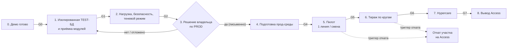

# 17. План перехода и внедрения в производство (cutover)

| | |
|---|---|
| **Назначение** | Поэтапный план внедрения MES в производство: этапы, ворота go/no-go, миграция и сосуществование с Access, откат, риски, роли. **Это план-решение, а не инструкция к действию.** |
| **Для кого** | Владелец проекта и РП (решения), ИТ (среда), технический руководитель, руководитель производства. |
| **Проверено по коммиту** | `fc6f055` (ветка `claude/new-session-bizv59`) |
| **Связанные документы** | [16-BACKLOG](16-BACKLOG.md) (что надо доделать), [18-ROLLOUT-CHECKLISTS](18-ROLLOUT-CHECKLISTS.md) (чек-листы и шаблоны), [09-SECURITY-AND-CONSTRAINTS](09-SECURITY-AND-CONSTRAINTS.md), [11-OPERATIONS-AND-STAND](11-OPERATIONS-AND-STAND.md), [06-DATA-AND-SQL](06-DATA-AND-SQL.md), [AS_IS_FACTS](../AS_IS_FACTS.md), [SPRINT00_ACCESS_AUDIT](../SPRINT00_ACCESS_AUDIT.md), [SECURITY_AND_DEPLOYMENT](../SECURITY_AND_DEPLOYMENT.md) |

## Оглавление

1. [Цели и принципы](#1-цели-и-принципы)
2. [ЗАПРЕТ на подключение к PROD и процедура его пересмотра](#2-запрет-на-подключение-к-prod-и-процедура-его-пересмотра)
3. [Что делают SQL-скрипты, читающие PROD, и как это соотносится с запретом](#3-что-делают-sql-скрипты-читающие-prod-и-как-это-соотносится-с-запретом)
4. [Целевая картина: что значит «в проде»](#4-целевая-картина-что-значит-в-проде)
5. [Стратегия внедрения: варианты и рекомендация](#5-стратегия-внедрения-варианты-и-рекомендация)
6. [Этапы и ворота go/no-go](#6-этапы-и-ворота-gono-go)
7. [Миграция данных и сосуществование с Access](#7-миграция-данных-и-сосуществование-с-access)
8. [Обучение и документация](#8-обучение-и-документация)
9. [Роли и RACI](#9-роли-и-raci)
10. [Коммуникации](#10-коммуникации)
11. [План отката](#11-план-отката)
12. [Риски и меры](#12-риски-и-меры)
13. [Метрики успеха и наблюдаемость](#13-метрики-успеха-и-наблюдаемость)
14. [Открытые вопросы к владельцу](#14-открытые-вопросы-к-владельцу)

---

## 1. Цели и принципы

**Цель:** заменить рабочий процесс на базе Access/VBA ([AS_IS_FACTS](../AS_IS_FACTS.md)) веб-системой FormulaD MES 2.0 без остановки производства, потери данных и ослабления безопасности.

**Принципы (в порядке приоритета):**

1. **Безопасность превыше скорости.** Ни один этап не оправдывает подключение к PROD без явного решения владельца (раздел 2).
2. **Обратимость.** Каждый этап имеет план отката, проверенный заранее (раздел 11). Нельзя переходить к следующему этапу, не отрепетировав откат текущего.
3. **Поэтапность и ворота.** Переход к следующему этапу — только по выполнению критериев go/no-go (раздел 6) и записанному решению ответственного.
4. **Без угадывания.** Неизвестное о предприятии (люди, сроки, хосты, объёмы, правила) остаётся плейсхолдером `<определить: …>` и вопросом к владельцу (раздел 14).
5. **Одна «система записи» на изделие.** В любой момент для каждого изделия известно, какая система является источником истины и куда пишет (раздел 7).
6. **Измеримость.** Успех этапа определяется метриками и сверкой данных, а не ощущениями (раздел 13).

---

## 2. ЗАПРЕТ на подключение к PROD и процедура его пересмотра

### 2.1. Формулировка владельца

> PROD (`SQLACCESS` / база `FormulaD`) не подключается никогда в рамках этой работы — это **не отдельный дальний этап, это постоянный запрет**.

Источники формулировки: [DEVELOPMENT_PLAN](../DEVELOPMENT_PLAN.md) (Этап 11) и [CODEX_START](../CODEX_START.md), п. 0 («Непреодолимые запреты»); подтверждено владельцем в рабочей сессии. **В текущей редакции запрет ДЕЙСТВУЕТ.** Этот документ **не** разрешает и не планирует подключение к PROD; он описывает, что потребуется, **если** владелец примет такое решение.

### 2.2. Как запрет зашит в код (проверено по `SqlOptions.cs`)

Файл: [`src/FormulaD.Mes.Api/SqlOptions.cs`](../../src/FormulaD.Mes.Api/SqlOptions.cs). Класс `SqlOptions.Create(IConfiguration)` — «fail-closed»: любая неполная или похожая на PROD конфигурация приводит к исключению **при старте**, до попытки соединения.

| Барьер | Что проверяется | Откуда настройка |
|---|---|---|
| **Флаг тестовой среды** | `Sql:IsTestEnvironment` должен быть `true`, иначе исключение: «DataSource='Sql' требует явного подтверждения тестовой среды… PROD-подключение этим приложением не поддерживается». | `Sql:IsTestEnvironment` / переменная `Sql__IsTestEnvironment` |
| **Запрещённые базы** | `ForbiddenDatabases = ["FormulaD"]`; сравнение **регистронезависимое** с `Initial Catalog`. Пустой `Initial Catalog` — тоже отказ. | константа в коде |
| **Запрещённые логины** | `ForbiddenLogins = ["sa", "sa1"]`; регистронезависимо, по `User ID`. | константа в коде |
| **Обязательная строка** | Пустая `Sql:ConnectionString` — отказ; строк подключения в репозитории нет. | user-secrets / env |
| **Источник данных** | `DataSource` по умолчанию `Demo`; любое значение кроме `Demo`/`Sql` — исключение, без fallback на Demo или PROD. | `DataSource` |
| **Ограничения соединения** | `ConnectTimeout` ≤ 15 с; `ApplicationName`; для чтения принудительно `ApplicationIntent=ReadOnly` (страховка, **не** замена прав логина). | `SqlOptions.Create` |

Что **не** проверяется (важно для оценки защиты):

- **Хост не проверяется.** Проверка хоста `SQLACCESS` была убрана сознательно (комментарий в коде: «допускается тестовая база на том же экземпляре, что и PROD»; тест `Accepts_Prod_Host_With_Test_Database` в [`SqlReaderTests.cs`](../../tests/FormulaD.Mes.Api.Tests/SqlReaderTests.cs)). Документ [IMPLEMENTATION_REPORT](../IMPLEMENTATION_REPORT.md) в этой части устарел.
- Защита опирается на **имя** базы. Если на экземпляре существует другая база с именем без слова `FormulaD`, содержащая боевые данные, или тестовую базу восстановят/назовут иначе, код её пропустит. Предлагаемое усиление — задача **T-002** в [16-BACKLOG](16-BACKLOG.md) (allow-list и проверка `DB_NAME()` после подключения).
- Реальная гарантия «только чтение» — права SQL-логина, а не код. Сейчас один и тот же логин используется и для чтения, и для записи (**T-003**).

Тесты барьеров в `SqlReaderTests.cs`: `Requires_Explicit_Test_Environment_Marker` (нет флага → отказ), `Requires_Connection_String_From_Secrets` (нет строки → отказ), `Rejects_Prod_Database_And_Admin_Logins` (база `FormulaD`, логин `sa1` → отказ), `Accepts_Prod_Host_With_Test_Database` (хост PROD с базой TEST допустим), `Accepts_Test_Instance_And_Forces_ReadOnly_Intent`. Тесты работают без SQL Server.

### 2.3. Что значит «в прод» при действующем запрете

Пока запрет действует, **все этапы 0–2 и подготовительная часть 4 выполнимы без PROD**: Demo-стенд и **изолированная** TEST-БД с обезличенными/синтетическими данными. Любой шаг, требующий подключения приложения к `FormulaD`, **заблокирован** до оформленного решения владельца.

### 2.4. Процедура принятия решения владельцем о снятии/изменении запрета

Решение — **письменное, явное, с ограниченным объёмом**. «Да, давай» в рабочем чате решением не считается.

1. **Инициатор** (РП/технический руководитель) готовит пакет: что именно требуется (чтение / запись; какая база; какой режим — см. 6.4), зачем, какие ворота пройдены (чек-лист Go/No-Go этапа 3 в [18-ROLLOUT-CHECKLISTS](18-ROLLOUT-CHECKLISTS.md)), оценка рисков (раздел 12), план отката.
2. **Независимая проверка** (OQ-10 из [OPEN_QUESTIONS](../OPEN_QUESTIONS.md): кто в команде независимо проверит авторизацию, SQL, deployment и DR): отчёт «безопасность, SQL, развёртывание, восстановление».
3. **Решение владельца** по шаблону (раздел 6 в [18-ROLLOUT-CHECKLISTS](18-ROLLOUT-CHECKLISTS.md)): ссылка на формулировку запрета, **точный объём** разрешения (режим, база, логин, срок действия, кто исполняет), условия, при которых разрешение аннулируется. Подписывает владелец (`<определить: должность>`); копия хранится вне репозитория и в журнале решений.
4. **Только после** подписанного решения вносятся изменения (2.5). Решение не отменяет запреты на `sa`/`sa1`, на секреты в репозитории и на подключение к `FormulaD` любыми другими путями.
5. **Периодический пересмотр**: разрешение имеет срок и снимается автоматически по его истечении `<определить: срок>`.

### 2.5. Что потребуется изменить при снятии/изменении запрета (если решение будет принято)

Не снимать запрет «удалением строки». Предпочтительно ввести **отдельный, явный и узкий механизм** разрешения конкретного окружения, оставив защиту по умолчанию включённой.

| Область | Что менять | Тесты и проверки |
|---|---|---|
| Код: `SqlOptions.cs` | Не удалять `FormulaD` из `ForbiddenDatabases`, а добавить явное разрешение (например, `Sql:Environment=Production` + allow-list имён + второй флаг и сопоставление с хостом/логином), действующее только вне `Development`. `<определить: конкретный дизайн в ADR>`. | Новые тесты: без разрешения — отказ (как сегодня); с разрешением, но не тем логином/базой — отказ; `sa`/`sa1` — отказ всегда. Старые тесты запрета остаются. |
| Код: логины | Раздельные reader/writer (**T-003**); прод-логин без DDL и без прав на лишние таблицы. | Интеграционный тест прав (**T-021**). |
| Код: схема | Убрать runtime DDL (**T-004**), применять миграции скриптами DBA (**T-029**). | Приложение стартует под логином без `db_ddladmin`. |
| Код: аудит | Персистентный журнал событий (**T-005**): в SQL-режиме сегодня журнал в памяти. | Событие сохраняется при перезапуске. |
| Конфигурация | `appsettings.Production.json` вне репозитория; секреты — не в файле (**T-006**); HTTPS и порт (**T-105**). | Проверка среды ([18](18-ROLLOUT-CHECKLISTS.md), раздел 2). |
| Документы | Обновить [CODEX_START](../CODEX_START.md) п. 0, [DEVELOPMENT_PLAN](../DEVELOPMENT_PLAN.md) Этап 11, [SECURITY_AND_DEPLOYMENT](../SECURITY_AND_DEPLOYMENT.md), [README](../../README.md), [09-SECURITY-AND-CONSTRAINTS](09-SECURITY-AND-CONSTRAINTS.md): запрет исторически сформулирован как постоянный. | Ревизия документов записана в журнале решений. |
| Процесс | Решение владельца (2.4), независимая проверка, окно работ, откат. | Чек-листы [18](18-ROLLOUT-CHECKLISTS.md). |

Блокирующие условия PROD, уже зафиксированные в [SECURITY_AND_DEPLOYMENT](../SECURITY_AND_DEPLOYMENT.md): восстановление `FormulaD` из подтверждённой отдельной резервной копии **не испытано** (R-001); не одобрены техническая учётная запись, политика auth, HTTPS, порт и сегментация; не проверены пиковые нагрузки, совместимость с Access, откат и эксплуатационная приёмка. «Возможность загрузить приложение на сервер не является разрешением на ввод в эксплуатацию».

---

## 3. Что делают SQL-скрипты, читающие PROD, и как это соотносится с запретом

В репозитории есть скрипты, **читающие PROD**. Они исполняются **человеком с правами DBA вне приложения** (в SSMS/`sqlcmd`), а не самим MES. Выводы ниже — по тексту скриптов; **кто и когда их запускал, в репозитории не записано (не подтверждено)**.

| Скрипт | Что делает (по тексту) | Читает PROD? | Пишет куда | Замечания |
|---|---|---|---|---|
| [`sql/export-schema-from-prod.sql`](../../sql/export-schema-from-prod.sql) | «ТОЛЬКО ЧТЕНИЕ МЕТАДАННЫХ». `USE [FormulaD]`, читает `sys.tables`, `sys.columns`, индексы и т. п.; печатает DDL (в «Сообщения») для создания структуры на `FormulaD_TEST`. Без `INSERT/UPDATE/DELETE`. Запускать на PROD от логина с `SELECT` на системные представления. | **Да** (метаданные) | Нигде (только вывод DDL) | Единственный из скриптов, чьё безопасное чтение явно заявлено. Но он **подключается к PROD**. |
| [`sql/copy-prod-to-test.sql`](../../sql/copy-prod-to-test.sql) | «ПОЛНАЯ КОПИЯ FormulaD → FormulaD_TEST (схема + данные)». Запускать на `SQLACCESS` от `sysadmin`/`db_owner` обеих баз. Создаёт недостающие таблицы в TEST (динамически из метаданных), для `tblProductionPlan` данные **перезаливаются** (`TRUNCATE` + `INSERT`), остальные — вставляются. | **Да** (`SELECT` данных через кросс-базовые запросы) | `FormulaD_TEST` | Копирует **реальные** данные (включая номера двигателей и т. п.) в TEST — это не «обезличено/синтетика», как требует [SECURITY_AND_DEPLOYMENT](../SECURITY_AND_DEPLOYMENT.md) для тестовой БД (**противоречие, требует решения владельца**). |
| [`sql/create-test-db.sql`](../../sql/create-test-db.sql) | Создаёт `FormulaD_TEST` и логин `mes_reader` (`db_datareader` в TEST) **на PROD-экземпляре** под `sa1`/логином с правами `CREATE DATABASE`/`CREATE LOGIN`; копирует схему и **данные** `tblProductionPlan` из `FormulaD` (`SELECT TOP 0 * INTO …`, затем `INSERT … SELECT`). | **Да** | `FormulaD_TEST`, `master` (создание логина) | Содержит литерал пароля — нарушение политики (**T-001**). Создаёт тестовую БД на том же экземпляре, что PROD (OQ-2 не решён). |
| [`sql/create-writer-login.sql`](../../sql/create-writer-login.sql) | Создаёт `mes_writer` на **TEST-экземпляре**; `GRANT SELECT/INSERT/UPDATE` на конкретные таблицы и колонки. Пароль — `CHANGE_ME`. | Нет | `master`, `FormulaD_TEST` | Комментарии устарели: утверждает, что часть таблиц «создаётся приложением» (**T-004**). |
| [`sql/readonly_templates.sql`](../../sql/readonly_templates.sql) | Параметризованные `SELECT`-шаблоны для TEST («НЕ запускать автоматически и НЕ в PROD»). | Нет | — | Справочный материал для разработчиков. |
| [`sql/inspect-schemas.sql`](../../sql/inspect-schemas.sql) | Снятие схем таблиц для SQL-реализации; `USE [FormulaD_TEST]`, запуск на TEST-экземпляре от логина с `SELECT`. | Нет (TEST) | — | Результат передаётся разработчику — убедиться, что в нём нет реальных данных. |

**Соотношение с запретом (честно):**

- Запрет в [DEVELOPMENT_PLAN](../DEVELOPMENT_PLAN.md) и [CODEX_START](../CODEX_START.md) адресован **приложению и ИИ-агенту разработки**: «не подключаться к PROD», «не создавать логины», «никаких `CREATE/INSERT/UPDATE/DELETE`». Скрипты `copy-prod-to-test.sql` и `create-test-db.sql` **выходят за этот буквальный список** (создают БД и логин, копируют данные) — они были добавлены позже и выполняются DBA вручную.
- Они **не изменяют PROD**, но **читают** его и работают на **том же экземпляре**. Для владельца это вопрос трактовки: «не подключается никогда» относится только к приложению или также к ручным действиям DBA? **Вопрос 1 в разделе 14.**
- До ответа: **агент/разработчик не запускает эти скрипты**, не предлагает их запустить и не использует результат их запуска как повод подключать приложение к PROD. Приложение подключается только к `FormulaD_TEST` (и только при `Sql:IsTestEnvironment=true`).
- Если владелец решит оставить практику копирования: нужны (а) обезличивание или явное разрешение на реальные данные в TEST, (б) отдельный экземпляр (T-020), (в) запись о том, кто и когда выполнил копию.

---

## 4. Целевая картина: что значит «в проде»

«В проде» — **не** «приложение запущено на сервере». Определение включает все пункты:

1. Реальные пользователи входят под **своими** учётными записями (корпоративный провайдер, **T-010/T-011**), права проверяются на сервере (**T-012**); DevAuth отключён.
2. Данные пишутся в **согласованную** БД под **минимальными** правами (раздельные логины, без DDL, **T-003/T-004**), все операции записи отражены в **персистентном** журнале (**T-005**).
3. Резервные копии подтверждены и **восстановление испытано** (**T-101**); откат релиза отрепетирован (**T-104**).
4. HTTPS, сеть, порт, служба Windows согласованы и проверены (**T-100, T-105**).
5. Оборудование (сканеры, принтеры, терминалы) проверено на посту (**T-060…T-062**).
6. Операторы обучены и допущены (**T-122**); есть дежурный и канал эскалации (раздел 10).
7. Утверждены правила (приоритет A/B вопросов спецификации): станции и ОТК, Rework/NCP, FOK, входной контроль ([16-BACKLOG](16-BACKLOG.md), «Сводный реестр открытых вопросов»).
8. Определена роль Access на время сосуществования и после (раздел 7).

Состав модулей первой поставки — вопрос **В-01** ([SPECIFICATION](../SPECIFICATION.md), раздел 30): «все модули или поочерёдно» — `<определить: владелец>`.

---

## 5. Стратегия внедрения: варианты и рекомендация

Контекст ограничений: запись в старой системе идёт **прямо в общие таблицы SQL** через ODBC (31 связанная таблица, [AS_IS_FACTS](../AS_IS_FACTS.md)); Access не атомарен при импорте и перестановке (R-01, R-02), повторный старт перезаписывает `StartDate` (R-03); резервирование не подтверждено (R-001); реально используемые формы Access не классифицированы (R-08).

| Критерий | A. Параллельная работа с Access (общая БД) | B. Пилот: одна линия / смена, остальные на Access | C. Big-bang (переключение сразу) |
|---|---|---|---|
| Суть | MES и Access одновременно пишут одни и те же изделия | MES — система записи для **ограниченного участка**; остальное на Access; чёткое разделение «кто пишет какое изделие» | Access отключается, все переходят на MES в день X |
| Риск потери/порчи данных | **Высокий**: гонки двух писателей без общих блокировок (R-02/R-03/R-04) | **Средний/низкий**: разделение по изделиям/линии исключает двойную запись | **Высокий**: нет «запасной» системы; ошибка = остановка |
| Откат | Сложный (двойные записи) | **Простой**: вернуть участок на Access, изделия участка доработать | Очень сложный, фактически невозможен без простоя |
| Нагрузка на людей | Двойной ввод или путаница | Умеренная: обучается ограниченная группа | Максимальная: учится вся площадка сразу |
| Скорость получения обратной связи | Средняя | **Высокая** на малой группе | Низкая (всё сразу) |
| Требования к зрелости (аудит, роли, бэкапы) | Те же | Те же, но с ограниченным радиусом ущерба | Те же, радиус ущерба максимален |
| Совместимость с запретом на PROD | Требует решения владельца (общая БД = PROD) | Требует решения владельца для боевого участка; **до него возможен теневой режим на TEST** (5.2) | Требует решения владельца |

### 5.1. Рекомендация

**Вариант B — поэтапный пилот на одной линии/смене** с жёстким правилом разделения записи («один изделие — одна система записи», раздел 7), с предшествующим **теневым режимом** (5.2) и последующим расширением кругами. **Big-bang отклоняется**: при неподтверждённом резервном копировании, непроверенном SQL-слое и неклассифицированных формах Access цена ошибки неприемлема. **Вариант A в чистом виде отклоняется**: двойная запись в общие таблицы воспроизводит известные дефекты Access (R-02, R-03).

Обоснование: B единственный даёт одновременно (а) ограниченный радиус ущерба, (б) простой откат, (в) реальную обратную связь от операторов. Это следует из документов (R-001, R-08, раздел «Неопределённости» в [AS_IS_FACTS](../AS_IS_FACTS.md)), а не из сроков предприятия, которые неизвестны (`<определить: ограничения по срокам>`).

### 5.2. Теневой режим (до решения по PROD)

Возможен **без подключения к PROD**: MES работает на **изолированной** TEST-БД с обезличенной копией данных `<определить: допустимость и способ обезличивания, вопрос 1>`; те же операции параллельно выполняются в Access (система записи — Access). Результат — сверка (T-112) и обратная связь операторов, **но MES не является источником истины**. Теневой режим снижает неопределённость до этапа 3, не нарушая запрет.

---

## 6. Этапы и ворота go/no-go

Общая схема (без дат; длительности — `<оценить>`):

| Этап | Длительность | Зависит от решения вне команды |
|---|---|---|
| 0 | `<оценить>` | нет |
| 1 | `<оценить>` | ИТ: изолированный экземпляр (OQ-2) |
| 2 | `<оценить>` | цех: участие операторов в теневом режиме |
| 3 | `<определить>` | **владелец** |
| 4 | `<оценить>` | ИТ, владелец |
| 5 | `<оценить>` | цех, владелец |
| 6 | `<оценить>` | цех |
| 7 | `<оценить>` | — |
| 8 | `<оценить>` | владелец |

### Этап 0. Готовность Demo (точка отсчёта)

**Содержание:** Demo-стенд (`./stand/stand.sh up/smoke/down`) показывает все модули; тесты зелёны; документация актуальна.

| | |
|---|---|
| **Вход** | Репозиторий на ветке разработки; стенд запускается ([11-OPERATIONS](11-OPERATIONS-AND-STAND.md)). |
| **Выход (G0)** | `smoke` зелёный; `dotnet test` и `npm run test` зелёные (числа — [10-TESTING](10-TESTING.md)); нет секретов в репозитории (T-001, T-007); CI для MES работает (T-090); документы синхронизированы (T-121); UX-долг P0 закрыт (T-076). |
| **Откат** | Не применим (локальная среда). |

### Этап 1. Изолированная TEST-БД и приёмка

**Содержание:** отдельный экземпляр/ВМ/контейнер SQL Server с обезличенными данными (T-020); миграции схемы (T-029, T-004); раздельные логины (T-003); персистентный журнал (T-005); первый прогон всего SQL-слоя; приёмка модулей по [ACCEPTANCE](../ACCEPTANCE.md) и AT-01…AT-28 ([SPECIFICATION](../SPECIFICATION.md), раздел 29).

| | |
|---|---|
| **Вход** | G0; решение ИТ о размещении TEST (OQ-2). |
| **Выход (G1)** | Приложение в `DataSource=Sql` против **изолированной** TEST проходит smoke и AT-01…AT-28; SQL-интеграционные тесты зелёные (T-021); защита от PROD усилена (T-002) и протестирована; журнал переживает перезапуск; транзакции/идемпотентность проверены (T-022); формула `ID` выяснена (T-023); сверка с Access на контрольных примерах без неклассифицированных расхождений. |
| **Откат** | Пересоздание TEST из скриптов; приложение возвращается на `DataSource=Demo`. |

### Этап 2. Нагрузка, безопасность, теневой режим

**Содержание:** нагрузочная проверка (T-092); независимая проверка безопасности/SQL/развёртывания (OQ-10); пентест-baseline (T-014); репетиция восстановления и отката (T-101, T-104); **теневой режим** (5.2) с группой операторов.

| | |
|---|---|
| **Вход** | G1. |
| **Выход (G2)** | Нагрузка в пределах утверждённых порогов `<определить: пороги>`; нет High/Critical замечаний независимой проверки; восстановление БД из копии **испытано** и время записано; откат релиза отрепетирован; в теневом режиме расхождения MES↔Access разобраны и приняты; решения по приоритету A вопросов спецификации записаны. |
| **Откат** | Отключить теневой режим; MES не влияет на производство (система записи — Access). |

### Этап 3. Решение владельца по PROD

**Содержание:** пакет решения (2.4): что разрешается (чтение/запись, какая база, режим), условия, срок. Это **ворота-решение**, а не техническая работа.

| | |
|---|---|
| **Вход** | G2; готовый пакет и независимая проверка. |
| **Выход (G3)** | Подписанное решение владельца по шаблону ([18](18-ROLLOUT-CHECKLISTS.md), раздел 6) — **или** записанный отказ/отсрочка (тогда продолжается теневой режим и совершенствование на TEST; запрет остаётся). |
| **Откат** | Не применим: пока решения нет, PROD не затронут. |

### Этап 4. Подготовка прод-среды (⛔ только после G3)

**Содержание:** изменения в коде/конфигурации по разделу 2.5; прод-учётные записи и права; службa Windows на целевой ВМ (T-100); HTTPS/DNS/порт (T-105); бэкап до начала работ; мониторинг и логи (T-102, T-103); **допустимый режим на первом шаге — по решению владельца**. Документы **не определяют** допустимые режимы работы приложения против PROD (не подтверждено); по коду технически возможна работа **только на чтение** (при отсутствии writer-строки после T-003 операции записи не регистрируются) — это один из вариантов для решения владельца, не рекомендация к исполнению.

| | |
|---|---|
| **Вход** | G3 (подписанное решение). |
| **Выход (G4)** | Среда по чек-листу «Предпусковая проверка» ([18](18-ROLLOUT-CHECKLISTS.md), раздел 2) и «Безопасность перед пилотом» (раздел 3) пройдена; свежий бэкап и подтверждённый путь восстановления; smoke прод-стенда зелёный; решение об окне запуска. |
| **Откат** | Откат конфигурации и службы на предыдущее состояние; отзыв прод-логинов; PROD в исходном состоянии (приложение не успело писать, либо запись откатывается по плану раздела 11). |

### Этап 5. Пилот: одна линия / смена

**Содержание:** ограниченная группа (`<определить: линия/смена, число пользователей>`); правило «одно изделие — одна система записи» (раздел 7); дежурный разработчик и представитель цеха на смене; ежедневная сверка; журнал инцидентов ([18](18-ROLLOUT-CHECKLISTS.md), раздел 8).

| | |
|---|---|
| **Вход** | G4; обученные и допущенные операторы пилотной группы (T-122); оборудование проверено (T-060…T-062); утверждены правила приоритета A. |
| **Выход (G5)** | Пилот пройден `<определить: длительность/объём изделий>` без инцидентов уровня «потеря данных» и «ложный статус»; ежедневные сверки без неразобранных расхождений; метрики раздела 13 в пределах порогов; обратная связь операторов обработана; решение РП/владельца о расширении. |
| **Откат** | Триггеры раздела 11; пилотный участок возвращается на Access, изделия в работе доводятся по правилу раздела 7. |

### Этап 6. Тираж по кругам

**Содержание:** постепенное добавление линий/смен/модулей (круг за кругом); на каждом круге — свой мини-пилот и ворота G5-подобные.

| | |
|---|---|
| **Вход** | G5. |
| **Выход (G6)** | Все запланированные участки работают на MES; Access для них — только чтение/справка; нагрузка и метрики в норме. |
| **Откат** | Откат круга (раздел 11); предыдущие круги не затрагиваются. |

### Этап 7. Hypercare

**Содержание:** усиленная поддержка `<определить: срок>`; разбор инцидентов; доработки P1/P2 по обратной связи ([16-BACKLOG](16-BACKLOG.md), веха M7).

| | |
|---|---|
| **Вход** | G6. |
| **Выход (G7)** | Срок без инцидентов P0/P1 `<определить>`; метрики стабильны; передача сопровождения штатной службе `<определить>`. |
| **Откат** | По-прежнему возможен по участкам до G8. |

### Этап 8. Вывод старой системы

**Содержание:** перевод Access в архив/только чтение; запрет записи в старую систему; архивирование выгрузки и кода (с учётом, что VBA содержит статический PIN — R-06, считать скомпрометированным); окончательное закрытие ODBC-связей.

| | |
|---|---|
| **Вход** | G7; решение владельца. |
| **Выход (G8)** | Access не пишет в SQL (права отозваны); архив сохранён; процессы, не перенесённые в MES, явно перечислены и приняты или перенесены (T-113). |
| **Откат** | Возврат прав на запись только по решению владельца; практическая обратимость после G8 ограничена — поэтому G8 принимается осторожно. |

---

## 7. Миграция данных и сосуществование с Access

### 7.1. Модель данных (что известно, что нет)

- MES читает и пишет **существующие таблицы** (`tblProductionPlan`, `tblNCP`, `tblComponent` и др., [06-DATA-AND-SQL](06-DATA-AND-SQL.md)) — то есть работает в **общей** БД со старой системой. Это следует из кода (`SqlProductionPlanReader`, `SqlNcpStore`, …); целевая модель «общая БД vs новая БД с миграцией» владельцем явно **не зафиксирована** (не подтверждено; вопрос 5 в разделе 14).
- **Новые** таблицы, которых нет в исходной схеме (входной контроль, отметки станций, журнал событий в SQL): сейчас создаются приложением на лету (F-5) — заменить миграциями (T-004, T-029).
- Объёмы на момент инвентаризации ([AS_IS_FACTS](../AS_IS_FACTS.md)): около 315 записей `tblProductionPlan`, 1205 `tblComponent`, 193 `tblNCP`; `tblQC_*` в основном пусты. Актуальные объёмы — `<определить>`.

### 7.2. Что переносится / что нет

| Данные | Подход | Проверка |
|---|---|---|
| План (`tblProductionPlan`) | Остаётся в общей таблице; MES пишет только разрешёнными переходами (условные `UPDATE`, T-022) | Сверка статусов/дат MES↔Access ежедневно (T-112) |
| NCP (`tblNCP`) | Общая таблица; модель NCP расширена (станция, раздельные комментарии, признак установки) — совместимость с Access проверить | Сверка по VIN на контрольных примерах |
| Справочники (компоненты, модели, цвета, поставщики) | Источник — SQL; редактирование только в одной системе `<определить>` | Сверка справочников |
| Входной контроль (Packing Lists) | В Access — `tblPL_Lines`; в MES — новые таблицы; **не мигрировать «вслепую»** | Решение по переносу истории `<определить>` |
| Журнал событий | Только вперёд (с момента запуска в MES); историю Access не создавать | — |
| `tblQC_*` | Не смешивать без проектирования ([DB_CONTRACT](../DB_CONTRACT.md)) | — |

### 7.3. Правило «одно изделие — одна система записи»

На время пилота и тиража для каждого изделия определена **система записи**: либо Access, либо MES. Нарушение правила — инцидент уровня P0.

- Способ закрепления: `<определить: по линии / по смене / по диапазону VIN / по флагу в таблице>`; механизм должен быть **технически принудительным** (права, флаг, проверка в API), а не организационным.
- Изделия, начатые в одной системе, **завершаются в ней же** (не «пересаживать» на полпути).
- Старые **общие таблицы импорта** `tblImportplan`/`tblPlanTemp` (R-02) на время сосуществования закрепляются за одной системой; параллельный импорт запрещён.

### 7.4. Запрет записи в старую систему

В документах нет прямого требования «MES не пишет в Access». Но MES работает **в той же SQL-базе**, а не в Access-файле; при этом:

- запрос `SQL_backup` Access **не запускать в PROD** (R-09 — это не резервная копия);
- MES **не использует** `tblUser.PasswordHash`, статический PIN и любые данные из VBA (запреты [CODEX_START](../CODEX_START.md));
- любые изменения схемы — только миграциями с откатом ([SPRINT00_ACCESS_AUDIT](../SPRINT00_ACCESS_AUDIT.md), «Запрет»).

### 7.5. Сверка данных

- Ежедневная сверка пилотной группы: список изделий, статусы, даты старта/завершения/FOK, открытые NCP — MES против Access (T-112); расхождение — инцидент, разбор до конца смены.
- До пилота — сверка на **обезличенных** контрольных примерах ([SECURITY_AND_DEPLOYMENT](../SECURITY_AND_DEPLOYMENT.md): «Сравнивать вывод тестового API и Access на контрольных обезличенных примерах»).
- Критерий: расхождение либо объяснено (известное отличие правил), либо исправлено; необъяснённых — ноль.

---

## 8. Обучение и документация

| Аудитория | Содержание | Формат | Допуск |
|---|---|---|---|
| Операторы линии | Скан-сценарии (старт, завершение, FOK, rework), станции, NCP, что делать при ошибке и кому звонить | Практика на Demo-стенде + памятки у поста (T-123) | Пробные операции в Demo без ошибок `<определить: критерий>` |
| Бригадиры/диспетчеры | Импорт и перестановка плана, печать JobCard, отчётность | Практика | Аналогично |
| Инспекторы ОТК / инженеры | FOK, Rework, NCP (деталь установлена / закрыть), печать NCP-листов | Практика | Аналогично |
| Кладовщики | Входной контроль: поставка, Packing List, HU, закрытие коробки | Практика | Аналогично |
| ИТ / эксплуатация | Развёртывание, обновление, откат, бэкап/восстановление, мониторинг, инциденты ([11-OPERATIONS](11-OPERATIONS-AND-STAND.md)) | Практикум на тестовой ВМ | Отрепетированный откат |
| Разработчики | Справочник [00-README](00-README.md), [12-DEVELOPER-WORKFLOW](12-DEVELOPER-WORKFLOW.md) | Самостоятельно + ревью | — |

Материалы: руководства по ролям (T-120), обновлённые скриншоты (T-121), журнал инцидентов ([18](18-ROLLOUT-CHECKLISTS.md), раздел 8). Программа обучения и ответственный — `<определить>` (T-122).

---

## 9. Роли и RACI

Роли и люди **не заданы** — ниже плейсхолдеры. R — исполняет, A — отвечает/утверждает, C — консультирует, I — информируется.

| Активность | Владелец `<определить>` | РП `<определить>` | Тех. руководитель `<определить>` | Разработчики `<определить>` | ИТ/DBA `<определить>` | Руководитель производства `<определить>` | Независимый ревьюер `<определить>` |
|---|---|---|---|---|---|---|---|
| Решение о снятии/изменении запрета PROD | **A** | R | C | C | C | C | C |
| Независимая проверка безопасности/SQL/DR | I | A | C | C | C | I | **R** |
| Изолированная TEST-БД и миграции | I | A | C | R | **R** | I | C |
| Бэкапы и восстановление | I | A | C | I | **R** | I | C |
| Реализация доработок (бэклог) | I | A | C | **R** | C | I | I |
| Приёмка модулей (AT-01…AT-28) | I | **A** | C | R | I | R | I |
| Прод-среда (служба, HTTPS, учётки) | A | C | C | R | **R** | I | C |
| Обучение операторов | I | A | I | C | I | **R** | I |
| Решение Go/No-Go по этапам | **A** | R | C | C | C | C | I |
| Ежедневная сверка в пилоте | I | A | C | R | I | **R** | I |
| Реагирование на инциденты | I | A | **R** | R | R | R | I |
| Откат | **A** | R | C | R | **R** | C | I |
| Вывод Access | **A** | R | C | C | R | C | I |

---

## 10. Коммуникации

| Событие | Кому | Канал `<определить>` | Когда |
|---|---|---|---|
| Решение по Go/No-Go этапа | Владелец, РП, тех. руководитель, ИТ, цех | `<определить>` | в день решения |
| Окно запуска / обновления | Операторы пилота, бригадиры, ИТ | `<определить>` | не позднее чем `<определить>` до начала |
| Начало/конец смены в пилоте | Дежурный, представитель цеха | `<определить>` | каждую смену |
| Инцидент P0/P1 | Владелец, РП, тех. руководитель, ИТ | `<определить: быстрый канал>` | немедленно |
| Откат | Все участники этапа | `<определить>` | немедленно, затем итоговый отчёт |
| Итоги этапа | Владелец, РП, цех | отчёт | по завершении этапа |

Эскалация: оператор → бригадир → дежурный разработчик → тех. руководитель → РП → владелец (`<определить: контакты и время реакции>`).

---

## 11. План отката

Общие положения: откат принимает решение **ответственный этапа** по триггерам; решение и время фиксируются в журнале инцидентов; **до пилота откат репетируется** (T-104).

### 11.1. Триггеры отката (любой — повод остановить и оценить)

| Триггер | Серьёзность |
|---|---|
| Потеря или порча данных (расхождение с Access, необъяснённое после смены) | P0 → откат участка |
| Изделие получило ложный статус / запись выполнена не той системой (нарушение 7.3) | P0 |
| Недоступность MES на посту дольше `<определить: N минут>` и нет обходного пути | P1 → откат участка |
| Отказ входа/прав (операторы не могут работать) | P1 |
| Обнаружение секрета/утечки/подключения не к той БД | P0, остановка, расследование |
| Нарушение запрета PROD (подключение вне решения владельца) | P0, немедленная остановка |
| Метрики этапа вне порогов (раздел 13) в течение `<определить>` | по решению |

### 11.2. Откат по этапам

| Этап | Шаги отката | Время `<определить>` | Ответственные |
|---|---|---|---|
| 0–1 | Вернуть `DataSource=Demo`; пересоздать TEST из скриптов | `<измерить>` | разработчики, ИТ |
| 2 (теневой) | Остановить теневой режим; Access остаётся системой записи | `<измерить>` | РП, цех |
| 4 | Остановить службу; вернуть конфигурацию/версию; отозвать прод-логины; проверить, что PROD не изменён сверх плана | `<измерить>` | ИТ/DBA, тех. руководитель |
| 5 (пилот) | Остановить MES-запись для участка; вернуть участок на Access; незавершённые изделия — по правилу 7.3; сверка; разбор | `<измерить>` | РП, руководитель производства, ИТ |
| 6 (тираж) | Откат **круга**; предыдущие круги не трогать | `<измерить>` | РП, ИТ |
| 7 | Как 5/6 по участкам | `<измерить>` | РП |
| 8 | Возврат прав записи Access — только по решению владельца | `<измерить>` | владелец, ИТ |

### 11.3. Откат релиза (код)

Остановка службы → установка предыдущего артефакта → при необходимости откат миграции (скрипт отката из T-029; **откат данных** — из подтверждённой резервной копии, T-101) → запуск → `smoke` ([stand.sh](../../stand/stand.sh) или прод-аналог) → запись в журнал. Процедура отрабатывается заранее на тестовой ВМ (T-104).

---

## 12. Риски и меры

Источники: [SPRINT00_ACCESS_AUDIT](../SPRINT00_ACCESS_AUDIT.md) (R-NN), [SECURITY_AND_DEPLOYMENT](../SECURITY_AND_DEPLOYMENT.md) (R-001), проверка кода ([16-BACKLOG](16-BACKLOG.md), раздел 2). Вероятность и влияние: В — высокая, С — средняя, Н — низкая; оценки **экспертные**, `<подтвердить командой>`.

| # | Риск | Вер. | Влияние | Митигирование | Задачи |
|---|---|---|---|---|---|
| 1 | **Восстановление БД не испытано** (R-001): при потере данных вернуть нечего | В | Критическое | Подтвердить расписание бэкапов; **испытать** восстановление; G2 не пройти без этого | T-101 |
| 2 | Нарушение запрета: подключение к `FormulaD` из-за ошибки конфигурации/алиаса БД | С | Критическое | Allow-list + проверка `DB_NAME()`; тесты-стражи; ревью конфигурации; запрет `sa`/`sa1` | T-002, T-007 |
| 3 | Аудит теряется при перезапуске (журнал в памяти) | В (сейчас) | Высокое | Персистентный журнал в одной транзакции с операцией | T-005 |
| 4 | Двойная запись Access+MES портит данные (R-02, R-03) | С | Высокое | Правило 7.3, принудительное разделение; условные `UPDATE` | T-022, T-111 |
| 5 | SQL-слой ни разу не выполнялся против реального SQL Server | В | Высокое | Изолированная TEST; интеграционные тесты; сверка с Access | T-020, T-021 |
| 6 | Нет реальной аутентификации/ролей (R-06) | В | Высокое | Провайдер идентичности, роли на сервере | T-010…T-012 |
| 7 | Неклассифицированные формы Access: потеряем непереписанный сценарий | С | Среднее | Классификация форм, опрос цеха, пилот на малом участке | T-113 |
| 8 | Формула `tblProductionPlan.ID` неизвестна (R-07): дубли/ошибки импорта | С | Высокое | Выяснить до публикации импорта в SQL | T-023 |
| 9 | Печать/сканеры работают иначе на цеховом оборудовании | С | Среднее | Проверка на реальном оборудовании до пилота | T-061, T-062 |
| 10 | Операторы не готовы/сопротивляются; ошибки из-за незнания | С | Среднее | Обучение, допуск, дежурный, памятки; малый пилот | T-120…T-123 |
| 11 | Перегрузка/деградация БД на общем экземпляре с PROD | Н/С | Высокое | Изолированная TEST; нагрузочный тест; мониторинг | T-020, T-092, T-103 |
| 12 | Секреты в репозитории/истории (пароль `mes_reader`) | В (факт) | Высокое | Ротация, очистка/решение по истории, сканер секретов | T-001, T-006 |
| 13 | Runtime DDL требует лишних прав у прикладного логина | В (факт) | Среднее | Миграции DBA вместо `CREATE TABLE` из кода | T-004 |
| 14 | Расхождение часовых поясов/`datetime` без зоны | С | Среднее | Политика (OQ-6), тесты на границах | T-024 |
| 15 | Нет CI: регрессии не ловятся | В (факт) | Среднее | CI для MES, покрытие | T-090, T-093 |
| 16 | Неутверждённые правила (станции, ОТК, Rework, FOK): реализуем не то | С | Высокое | Закрыть приоритет A вопросов до M5; не начинать этап 5 без решений | [16-BACKLOG](16-BACKLOG.md) |
| 17 | Копирование реальных данных в TEST без обезличивания | С | Высокое | Решение владельца (вопрос 1), обезличивание | раздел 3 |
| 18 | Незапланированная зависимость от 1С (формат, протокол неизвестны) | Н | Среднее | Адаптер за интерфейсом, не блокировать пилот | T-110 |

---

## 13. Метрики успеха и наблюдаемость

Пороги — `<определить совместно с цехом>`; здесь — **что** измерять и **откуда**.

| Метрика | Что означает | Источник | Порог / цель |
|---|---|---|---|
| Доля расхождений MES↔Access | Необъяснённые расхождения при ежедневной сверке | T-112 | 0 необъяснённых |
| Инциденты уровня P0/P1 | Потеря данных, ложный статус, простой | журнал инцидентов | 0 P0; P1 ≤ `<определить>` |
| Доступность | Доля времени, когда MES отвечает | мониторинг (`health/live`, `health/ready`, T-103) | `<определить>` |
| Время отклика (p95) | Для скана/перехода статуса и загрузки плана | логи/нагрузочный тест (T-092) | `<определить>` |
| Ошибки API | Доля 4xx/5xx по эндпоинтам | логи | `<определить>` |
| Время на операцию | Скан → подтверждение у оператора | замеры на смене | не хуже Access `<определить>` |
| Повторные сканы/отмены | Индикатор неудобства/ошибок | журнал событий | снижение со временем |
| Использование | Доля операций, выполненных в MES на участке | журнал событий | 100 % на пилотном участке |
| Обратная связь | Число обращений и их решение | журнал обращений | все обработаны |
| Время восстановления | RTO/RPO по результатам учений | отчёты учений (T-101/T-104) | `<определить>` |

**Наблюдаемость:** структурированные логи без секретов и без полных VIN по умолчанию (T-102); `health/live` (сейчас единственный) и `health/ready` (T-103); журнал событий как бизнес-аудит (T-005); дашборд метрик `<определить: инструмент>`; ежедневный отчёт дежурного.

---

## 14. Открытые вопросы к владельцу

Ниже — вопросы, без ответов на которые план не может быть исполнен. Полный реестр — в [16-BACKLOG](16-BACKLOG.md), «Сводный реестр открытых вопросов».

| № | Вопрос | Почему важно | Блокирует |
|---|---|---|---|
| **1** | Относится ли запрет «PROD не подключается никогда» только к приложению и ИИ-агенту или также к ручным скриптам DBA (`copy-prod-to-test.sql`, `create-test-db.sql`, `export-schema-from-prod.sql`), и допустимо ли копировать **реальные** данные в TEST? | Скрипты читают PROD и работают на одном экземпляре; требование «обезличено» противоречит копированию | этап 1, теневой режим |
| **2** | Будет ли когда-либо принято решение о подключении к PROD, и в каком режиме (только чтение / чтение+запись), на какой срок? Либо внедрение предполагает отдельную «прод-подобную» БД с собственным процессом синхронизации? | Определяет этап 3 и всю архитектуру внедрения | этапы 3–8 |
| **3** | Где разместить изолированную TEST (отдельная ВМ/экземпляр/контейнер), и кто её готовит? (OQ-2) | Сейчас TEST на том же экземпляре, что PROD | этап 1 |
| **4** | Есть ли подтверждённые резервные копии и кто испытал восстановление? (OQ-3, R-001) | Без этого PROD-этапы недопустимы | G2, этап 4 |
| **5** | Целевая модель данных: MES работает в **той же** БД, что Access (общие таблицы), или в новой БД с миграцией и синхронизацией? | Определяет сосуществование, откат, сверку | этапы 4–8 |
| **6** | Какой провайдер идентичности одобрен (AD/Windows, OIDC, иной), и кто независимо проверит безопасность, SQL, развёртывание, восстановление? (OQ-1, OQ-10) | Без реальной auth пилот невозможен | этап 4 |
| **7** | Утверждение правил приоритета A спецификации: 11 станций/ПК (В-02), ОТК и маршрут (В-03), ID при PK VIN (В-05), вход в Rework (В-07), QR (В-12), завершение станции (В-15), момент Rework (В-19), закрытие NCP/Rework (В-22/В-23), состав FOK (В-24) | Реализуем то, что не утверждено | этап 5 |
| **8** | Состав первой поставки (В-01): все модули или поочерёдно? Какая линия/смена для пилота, сроки и ограничения? | Определяет объём и график | этапы 5–6 |
| **9** | Судьба Access после внедрения: архив, только чтение, полный вывод; какие формы остаются (В-36, R-08)? | Этап 8 и правила сосуществования | этапы 5–8 |
| **10** | Нужна ли интеграция с 1С к моменту пилота (И-01…И-06) или пилот идёт на Excel-импорте? | Влияет на импорт плана и объём | этап 5 |
