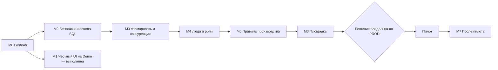

# 20. План разработки

> **Назначение:** один документ, по которому видно, что уже сделано, что блокирует дальнейшую работу, в каком порядке и что делать в ближайших спринтах. Детали задач — в [16-BACKLOG.md](16-BACKLOG.md), план перехода и внедрения — в [17-PRODUCTION-CUTOVER-PLAN.md](17-PRODUCTION-CUTOVER-PLAN.md), чек-листы — в [18-ROLLOUT-CHECKLISTS.md](18-ROLLOUT-CHECKLISTS.md).
> **Для кого:** владелец, руководитель проекта, разработчики.
> **Состояние на:** 2026-11-05, ветка `claude/new-session-bizv59`.
> **Договорённость:** даты и длительности не выдуманы: `<оценить>` заполняется командой. Порядок и зависимости обязательны, сроки нет.

## Оглавление

1. [Где мы сейчас](#1-где-мы-сейчас)
2. [Что блокирует дальнейшую работу: решения владельца](#2-что-блокирует-дальнейшую-работу-решения-владельца)
3. [Порядок работ: вехи и зависимости](#3-порядок-работ-вехи-и-зависимости)
4. [Ближайшие спринты](#4-ближайшие-спринты)
5. [Условия выхода на пилот](#5-условия-выхода-на-пилот)
6. [Главные риски](#6-главные-риски)
7. [Как вести этот план](#7-как-вести-этот-план)

---

## 1. Где мы сейчас

**Готово (проверено запуском и тестами):**

| Область | Состояние |
|---|---|
| Приложение на синтетических данных (режим `Demo`) | Работает: 11 экранов (план, импорт, старт, станции, завершение, FOK, Rework, несоответствия, входной контроль, отчётность, администрирование) |
| Интерфейс | Все экраны в едином стиле F7: светлая и тёмная темы, сворачиваемое меню и очередь, вспышка результата скана, скелетоны, пустые состояния, режим планшета |
| Бэкенд | 44 эндпоинта; 143 теста проходят |
| Фронтенд | 79 тестов проходят |
| Стенд | Запуск одной командой: `formulad-mes2/stand/stand.sh up`, проверка `smoke` (11 пунктов) |
| Документация | Справочник разработчика (21 файл) в `formulad-mes2/docs/handbook/`; ссылки проверены |
| Защита от PROD | Код отклоняет базу `FormulaD`, логины `sa`/`sa1` и запуск без флага тестовой среды |

**Не готово (определяет остальной план):**

| Проблема | Почему важна | Задача |
|---|---|---|
| В `sql/create-test-db.sql` лежит открытый пароль тестового логина | Нарушает правило «секретов в репозитории нет»; уже в истории git | T-001 |
| Защита от PROD держится на запрете имени `FormulaD`, а не на разрешённом списке | Копия PROD под другим именем пройдёт проверку | T-002 |
| SQL-слой не запускался на реальной тестовой базе | Все SQL-пути проверены только на фикстурах и заменителях | T-020, T-021 |
| В SQL-режиме одна строка подключения и для чтения, и для записи; приложение само создаёт таблицы | Нет разделения прав; изменение схемы из приложения | T-003, T-004 |
| Журнал событий хранится только в памяти и не читается через API | Теряется при перезапуске; нет аудита | T-005 |
| Вход только dev-режимом (разрешён лишь в Development) | В рабочей среде служба Windows окажется закрытой; нет ролей | T-010…T-012 |
| Нет CI и сквозных (E2E) тестов | Регрессии ловятся только руками | T-090, T-091 |
| Не испытано восстановление базы из копии | При потере данных вернуть нечего | T-101 |

## 2. Что блокирует дальнейшую работу: решения владельца

Без этих ответов часть вех нельзя начать. Это не технические вопросы. Полный реестр — в конце [16-BACKLOG.md](16-BACKLOG.md).

| № | Решение | Блокирует |
|---|---|---|
| 1 | Постоянный запрет на PROD касается только приложения или и скриптов DBA, которые читают PROD (`sql/copy-prod-to-test.sql`, `sql/export-schema-from-prod.sql`)? | T-002, всё, что связано с копией данных |
| 2 | Можно ли копировать реальные данные в тестовую базу и в каком виде (обезличивание)? | T-020, T-021 |
| 3 | Где разместить отдельную тестовую БД (хост, экземпляр, кто администрирует)? | M2 целиком |
| 4 | Каким будет целевой режим работы с PROD (параллельно со старой системой, пилот на одной линии, иначе) и снимается ли запрет | M6, этапы 3…8 плана перехода |
| 5 | Какой провайдер идентичности одобрен (корпоративный каталог и т. п.) | M4 целиком |
| 6 | Кто меняет пароль тестового логина на сервере и когда | T-001 |

Решения 4 и 5 оформляются письменно; шаблон решения о запрете на PROD — в [18-ROLLOUT-CHECKLISTS.md](18-ROLLOUT-CHECKLISTS.md). **Пока решения 4 нет, запрет на PROD действует, и ни один шаг плана не требует подключения к PROD.**

## 3. Порядок работ: вехи и зависимости

| Веха | Цель | Состояние | Главные задачи |
|---|---|---|---|
| **M0. Гигиена** | Репозиторий без секретов, CI зелёный, документы честные | **не начата, делать первой** (дёшево и снимает риск) | T-001, T-006, T-007, T-090, T-093, T-121 |
| **M1. Честный UI на Demo** | Оператор не видит ложных данных, терминальный режим удобен | **выполнена по P1-задачам**; остались P2: командная палитра (T-085), квадроциклы по модели и цвету (T-086) | см. EPIC-06 |
| **M2. Безопасная основа SQL** | Приложение подключается только к изолированной тестовой базе, права раздельные, схема под миграциями | не начата, **нужны решения 2 и 3** | T-002, T-003, T-004, T-005, T-029, T-020 |
| **M3. Атомарность и конкуренция** | Два оператора и повторный скан не портят данные | не начата | T-021, T-022, T-023, T-091 |
| **M4. Люди и роли** | Вход по корпоративной учётной записи, права на сервере | не начата, **нужно решение 5** | T-010, T-011, T-012 |
| **M5. Правила производства** | Утверждённые владельцем правила реализованы | не начата | T-043…T-053 |
| **M6. Площадка** | Оборудование и эксплуатация готовы к пилоту | не начата | T-060, T-100, T-101, чек-листы 18 |
| **M7. После пилота** | Улучшения по обратной связи | — | P2 |

M0 и M2 можно вести параллельно с остатками M1. После M2 дальше строго по порядку: без раздельных прав и атомарных переходов нельзя доверять данным, без ролей нельзя выходить на площадку.

## 4. Ближайшие спринты

Длительность спринта `<оценить>`; важен состав. Каждый спринт заканчивается демонстрируемым результатом.

### Спринт 1: гигиена (M0)

| Задача | Что делаем | Результат |
|---|---|---|
| T-001 | Убираем пароль из `sql/create-test-db.sql` (передача параметром, как в `create-writer-login.sql`), владелец меняет пароль на сервере | В репозитории нет пароля; логин ротирован |
| T-006 | Политика секретов: что и где хранится, сканер секретов | Сканер в проверках |
| T-090 | CI: сборка, тесты бэка и фронта, сканер секретов | Зелёный CI на каждый коммит |
| T-093 | Измерить покрытие, зафиксировать порог | Число в отчёте CI |
| T-121 | Обновить устаревшие документы по [15-LEGACY-DOCS-MAP.md](15-LEGACY-DOCS-MAP.md) или заархивировать | Нет документов, противоречащих коду |
| T-002 + T-007 | Защита от PROD по белому списку (`FormulaD_TEST`) и тесты, которые падают при её ослаблении | Копия PROD под другим именем отклоняется |

**Демонстрация:** пуш с паролем в файле отклоняется CI; запуск с базой `FormulaD_Prod` отклоняется на старте.

### Спринт 2: безопасная основа SQL (M2, часть 1; нужны решения 2 и 3)

| Задача | Что делаем | Результат |
|---|---|---|
| T-020 | Изолированная тестовая БД, первый прогон SQL-слоя | Стенд работает на тестовой базе |
| T-029 | Версионирование схемы (миграции) | Схема воспроизводима с нуля |
| T-004 | Убрать создание таблиц из приложения | Приложение не меняет схему |
| T-003 | Раздельные логины чтения и записи | Логин «только чтение» не может писать |

**Демонстрация:** создание тестовой базы с нуля скриптом, прохождение сценария «план → старт → завершение → FOK» на SQL.

### Спринт 3: данные, на которые можно положиться (M2 часть 2 и M3)

| Задача | Что делаем | Результат |
|---|---|---|
| T-005 | Персистентный журнал событий | Журнал переживает перезапуск, есть чтение |
| T-021 | Интеграционные SQL-тесты | Тесты на настоящей базе в CI |
| T-022 | Транзакции, идемпотентность, конкуренция | Повторный скан и два оператора не портят данные |
| T-023 | Формула `tblProductionPlan.ID` (разрыв со спецификацией) | Формула определена по спецификации и закреплена тестами |

**Демонстрация:** два одновременных подтверждения одного VIN — одно проходит, второе получает понятный отказ.

### Дальше

Спринты 4…N по вехам M4 (роли), M5 (правила производства), M6 (площадка) собираются из [16-BACKLOG.md](16-BACKLOG.md) после того, как закрыты решения 5 и 4. Порядок внутри вех — по приоритету и зависимостям из бэклога.

## 5. Условия выхода на пилот

Пилот возможен только когда выполнены **все** условия:

- [ ] Закрыты вехи M0…M6.
- [ ] Пройдены чек-листы «Среда», «Безопасность перед пилотом» и приёмка по AT-01…AT-30 из [18-ROLLOUT-CHECKLISTS.md](18-ROLLOUT-CHECKLISTS.md).
- [ ] Испытано восстановление базы из резервной копии (T-101).
- [ ] Есть **письменное решение владельца** о режиме работы с PROD (решение 4) по шаблону из чек-листов.
- [ ] Определены ответственные, обучены операторы, готов план отката.

## 6. Главные риски

| Риск | Что делаем |
|---|---|
| Восстановление базы не испытано | T-101 до пилота |
| SQL-слой ни разу не гонялся на реальной базе | Спринт 2 первым же делом |
| Нет реальной аутентификации и ролей | Веха M4; до неё доступ только на закрытом стенде |
| Решения владельца затягиваются (особенно 3 и 5) | Вести реестр решений, поднимать на каждой демонстрации |
| Требования производства неполные (открытые вопросы В-NN) | Закрывать по приоритету до M5 |

Полная таблица с вероятностью и влиянием — в [17-PRODUCTION-CUTOVER-PLAN.md](17-PRODUCTION-CUTOVER-PLAN.md).

## 7. Как вести этот план

- После каждого спринта обновлять отметки в [16-BACKLOG.md](16-BACKLOG.md) (✅ сделано, ◐ частично) и раздел «Состояние» здесь.
- Новые задачи заводить в бэклог с критериями приёмки; новые замечания к интерфейсу — в [19-UX-REVIEW-NOTES.md](19-UX-REVIEW-NOTES.md).
- Решения владельца фиксировать письменно и вносить в реестр вопросов.
- Определения «готова к взятию» и «закрыта» — в конце [16-BACKLOG.md](16-BACKLOG.md).
